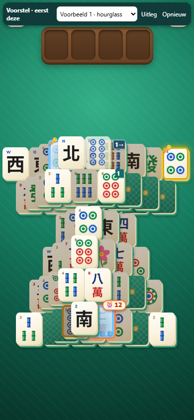
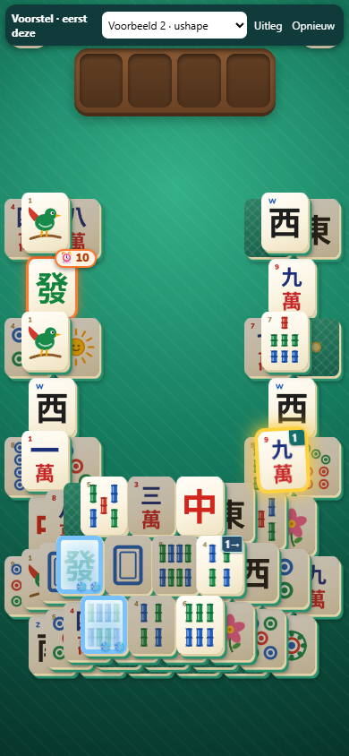
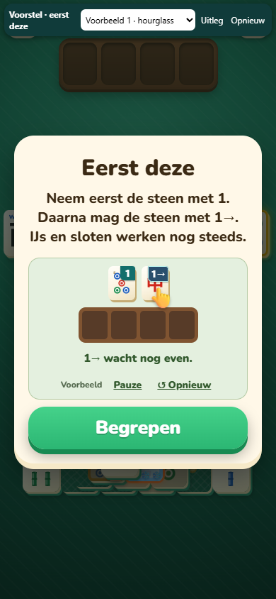

# TASK 14 — trap variety

**Complete: 30 independently verified boards across 12 new mixed-trap families.**

Branch: `wip/codex-trap-variety`, based on local `wip/cc-builder-loop` at `a9c67e90`. The mixed-trap work uses new companion builder files. The task’s explicit new-mechanic section also adds an opt-in ribbon prototype to the engine, game and packed format, with the completed Task 13 marker dependency. No game levels, published files, main or Firebase were changed. No family/skilled ratings were run.

Task 13 was already completed separately on `wip/codex-ui-markers` (`1244e794`); its report and screenshots are in that branch. Its marker, hint and coach display changes and focused tests are incorporated here for the playable prototype. Frozen-key and frozen-lock cards retain `needsUi: TASK-13` as an integration dependency for any consumer of the board bank.

## Delivered families

| Family | What the player has to see | Recipe | Current observed sweep hosts | Raw builds / jobs | Example layouts |
|---|---|---|---|---:|---|
| splitThawLocks | The locked thaw tile clears a picture carried through the key dig; save the free clock’s tray slot until that relief is ready. | The same keys open the clock partner and a locked picture match on its thaw route. | 36, 46 | 2/48 | 36, 46 |
| nestedMeltFork | Prepare both frozen thaw exits and save the lonely outer neighbour for its buried partner. | A two-front staged thaw, rather than one serial ice chain. | 0, 1, 5, 16, 17, 24, 28, 31, 47 | 9/48 | 13, 17, 28, 47 |
| keyRoofMeltFork | Thaw the key roof through its own neighbour before collecting the two keys together. | A staged melt on the key side rather than the clock side. | 1, 3, 4, 13, 21, 23, 30, 31, 33, 36, 37, 46 | 12/48 | 18, 21 |
| freeClockIce | The clock is already free, but taking it now uses the tray space needed for the two-stage thaw of its partner. | A takeable clock competes with its nested frozen partner route. | 1, 3, 31 | 3/48 | 3, 31 |
| freeClockKeys | Leave the exposed clock until the frozen key roof is cleared, or its waiting picture blocks the key dig. | A free clock in parallel with a keyed ice gate. | 0, 2, 4, 6, 9, 11, 14, 15, 16, 18, 23, 27, 30, 31, 33, 35, 36, 39, 42, 43, 46 | 21/48 | 42, 9 |
| freeClockShared | The free clock and the free melting neighbour compete for tray room while the keys open the clock partner route. | A clock bait beside a shared-lock thaw fork. | 1, 3, 14, 16, 18, 29, 31, 36, 46 | 9/48 | 0, 29, 36 |
| frozenKeyShared | The frozen key opens two separate exits, so thaw its route before spending a slot on the other key. | A frozen key feeding a branched lock mechanism. | 18, 23 | 2/48 | 19, 27 |
| frozenRoofShared | The free clock shares its picture with a tile behind a roof that is both frozen and locked; prepare the far key route first. | A free clock and its partner beneath a frozen locked roof, linked to an icy key cover. | 14, 18, 31, 36, 43, 46 | 6/48 | 1, 18, 23 |
| secondActIce | Saving the clock leaves an icy gate in the remaining picture route; keep space for the tiles that melt it. | An independently measured obstacle after the clock. | 2, 9, 15, 21, 23, 27, 31, 35, 46, 47 | 10/48 | 14, 36 |
| roofKeyGuard | The easy key lies on the clock, but its partner is behind an icy roof on the other side. | A clock-cover key competes with a separate frozen key roof. | 0, 4, 9, 12, 13, 15, 17, 18, 23, 24, 31, 37, 39 | 13/48 | 16, 24, 39 |
| repeatedKeyChoice | Pictures can match while only one key leaves: pair the two real keys rather than the free key and its ordinary lookalike. | Four copies make the wrong matching pair a trap. | 7, 8, 19, 20, 25, 29, 31, 32, 34, 36, 37, 38, 39, 41, 44 | 15/48 | 19, 7, 8 |
| repeatedFrozenKey | The ordinary lookalike cannot replace the frozen key: thaw and pair the actual keys before using the shared picture elsewhere. | Four-copy choice across a frozen key and a clock thaw exit. | 4, 9, 13, 27, 29, 30, 31, 35, 36, 38, 39, 47 | 12/48 | 37, 38 |

Every family has its own `place()` and `prove()`, unique `mix:<name>` ledger type, see sentence and easier/harder dials. The common easier dial is spare 2; harder is spare 1, additional wrong neighbours where supported, and tail weave width 3. These are construction dials, not guarantees that every setting yields a board.

A raw build proves the route, bait, openings and special effects. It is not a finished example: separation and tail tuning can still reject it. Layout ids are 0–47. Host sets are observed lower bounds from the bounded full-catalogue sweeps; a failure is not a proof that a layout cannot host a family. Each sweep JSON records its seed, spare, attempts, hard wall and failures. Final examples can demonstrate additional hosts.

## Thirty examples and their cards

See [the example table](../../../source/analysis/builder/bank/variety-v1/examples/CARDS.md), [selection order](../../../source/analysis/builder/bank/variety-v1/selection.json), [family metadata](../../../source/analysis/builder/bank/variety-v1/families.json) and [independent audit](../../../source/analysis/builder/bank/variety-v1/audit-final.json). Each individual Markdown card includes the see sentence, bait prices, dearest unrelated price, winning openings, tray facts, tail measure, face-down share and a labelled schematic. The JSON beside it contains the complete board and strict winning solution.

| Example card | Family | Layout | Tiles | k + spare | Winning starts | Tail greedy win | Face down |
|---|---|---:|---:|---|---:|---:|---:|
| [splitThawLocks-L36-s8-p2](../../../source/analysis/builder/bank/variety-v1/examples/splitThawLocks-L36-s8-p2.md) | splitThawLocks | 36 | 76 | 11 + 2 | 2 | 0.2087 | 19.7% |
| [freeClockIce-L3-s2-p1](../../../source/analysis/builder/bank/variety-v1/examples/freeClockIce-L3-s2-p1.md) | freeClockIce | 3 | 80 | 7 + 1 | 2 | 0.2737 | 20.0% |
| [repeatedFrozenKey-L37-s1-p1](../../../source/analysis/builder/bank/variety-v1/examples/repeatedFrozenKey-L37-s1-p1.md) | repeatedFrozenKey | 37 | 84 | 5 + 1 | 4 | 0.2425 | 20.2% |
| [nestedMeltFork-L13-s3-p1](../../../source/analysis/builder/bank/variety-v1/examples/nestedMeltFork-L13-s3-p1.md) | nestedMeltFork | 13 | 96 | 7 + 1 | 2 | 0.1713 | 19.8% |
| [roofKeyGuard-L16-s5-p1](../../../source/analysis/builder/bank/variety-v1/examples/roofKeyGuard-L16-s5-p1.md) | roofKeyGuard | 16 | 74 | 15 + 1 | 4 | 0.3362 | 16.2% |
| [frozenKeyShared-L19-s6-p2](../../../source/analysis/builder/bank/variety-v1/examples/frozenKeyShared-L19-s6-p2.md) | frozenKeyShared | 19 | 76 | 12 + 2 | 4 | 0.2938 | 18.4% |
| [freeClockShared-L0-s5-p1](../../../source/analysis/builder/bank/variety-v1/examples/freeClockShared-L0-s5-p1.md) | freeClockShared | 0 | 80 | 7 + 1 | 2 | 0.3137 | 20.0% |
| [roofKeyGuard-L24-s1-p1](../../../source/analysis/builder/bank/variety-v1/examples/roofKeyGuard-L24-s1-p1.md) | roofKeyGuard | 24 | 76 | 9 + 1 | 2 | 0.29 | 19.7% |
| [secondActIce-L14-s1-p1](../../../source/analysis/builder/bank/variety-v1/examples/secondActIce-L14-s1-p1.md) | secondActIce | 14 | 80 | 8 + 1 | 3 | 0.2787 | 20.0% |
| [frozenRoofShared-L18-s6-p2](../../../source/analysis/builder/bank/variety-v1/examples/frozenRoofShared-L18-s6-p2.md) | frozenRoofShared | 18 | 76 | 11 + 2 | 5 | 0.3463 | 19.7% |
| [freeClockKeys-L42-s1-p1](../../../source/analysis/builder/bank/variety-v1/examples/freeClockKeys-L42-s1-p1.md) | freeClockKeys | 42 | 76 | 11 + 1 | 4 | 0.32 | 19.7% |
| [nestedMeltFork-L47-s3-p1](../../../source/analysis/builder/bank/variety-v1/examples/nestedMeltFork-L47-s3-p1.md) | nestedMeltFork | 47 | 96 | 4 + 1 | 11 | 0.3688 | 19.8% |
| [frozenKeyShared-L27-s2-p1](../../../source/analysis/builder/bank/variety-v1/examples/frozenKeyShared-L27-s2-p1.md) | frozenKeyShared | 27 | 96 | 12 + 1 | 2 | 0.2938 | 19.8% |
| [frozenRoofShared-L23-s6-p2](../../../source/analysis/builder/bank/variety-v1/examples/frozenRoofShared-L23-s6-p2.md) | frozenRoofShared | 23 | 76 | 11 + 2 | 8 | 0.2838 | 19.7% |
| [repeatedKeyChoice-L7-s2-p1](../../../source/analysis/builder/bank/variety-v1/examples/repeatedKeyChoice-L7-s2-p1.md) | repeatedKeyChoice | 7 | 80 | 7 + 1 | 3 | 0.3088 | 20.0% |
| [secondActIce-L36-s1-p1](../../../source/analysis/builder/bank/variety-v1/examples/secondActIce-L36-s1-p1.md) | secondActIce | 36 | 76 | 7 + 1 | 2 | 0.245 | 19.7% |
| [freeClockKeys-L9-s2-p1](../../../source/analysis/builder/bank/variety-v1/examples/freeClockKeys-L9-s2-p1.md) | freeClockKeys | 9 | 76 | 7 + 1 | 3 | 0.3688 | 19.7% |
| [roofKeyGuard-L39-s1-p1](../../../source/analysis/builder/bank/variety-v1/examples/roofKeyGuard-L39-s1-p1.md) | roofKeyGuard | 39 | 80 | 9 + 1 | 3 | 0.3013 | 20.0% |
| [keyRoofMeltFork-L21-s1-p1](../../../source/analysis/builder/bank/variety-v1/examples/keyRoofMeltFork-L21-s1-p1.md) | keyRoofMeltFork | 21 | 96 | 13 + 1 | 3 | 0.3225 | 19.8% |
| [freeClockIce-L31-s3-p1](../../../source/analysis/builder/bank/variety-v1/examples/freeClockIce-L31-s3-p1.md) | freeClockIce | 31 | 76 | 9 + 1 | 2 | 0.2475 | 19.7% |
| [repeatedKeyChoice-L19-s2-p1](../../../source/analysis/builder/bank/variety-v1/examples/repeatedKeyChoice-L19-s2-p1.md) | repeatedKeyChoice | 19 | 76 | 7 + 1 | 5 | 0.3225 | 19.7% |
| [nestedMeltFork-L28-s3-p1](../../../source/analysis/builder/bank/variety-v1/examples/nestedMeltFork-L28-s3-p1.md) | nestedMeltFork | 28 | 72 | 6 + 1 | 2 | 0.31 | 12.5% |
| [keyRoofMeltFork-L18-s2-p1](../../../source/analysis/builder/bank/variety-v1/examples/keyRoofMeltFork-L18-s2-p1.md) | keyRoofMeltFork | 18 | 76 | 11 + 1 | 2 | 0.3787 | 19.7% |
| [repeatedKeyChoice-L8-s2-p1](../../../source/analysis/builder/bank/variety-v1/examples/repeatedKeyChoice-L8-s2-p1.md) | repeatedKeyChoice | 8 | 84 | 8 + 1 | 3 | 0.2888 | 20.2% |
| [nestedMeltFork-L17-s4-p2](../../../source/analysis/builder/bank/variety-v1/examples/nestedMeltFork-L17-s4-p2.md) | nestedMeltFork | 17 | 76 | 6 + 2 | 11 | 0.3438 | 17.1% |
| [frozenRoofShared-L1-s7-p1](../../../source/analysis/builder/bank/variety-v1/examples/frozenRoofShared-L1-s7-p1.md) | frozenRoofShared | 1 | 76 | 11 + 1 | 6 | 0.3412 | 19.7% |
| [freeClockShared-L29-s5-p1](../../../source/analysis/builder/bank/variety-v1/examples/freeClockShared-L29-s5-p1.md) | freeClockShared | 29 | 96 | 7 + 1 | 2 | 0.2437 | 19.8% |
| [splitThawLocks-L46-s7-p1](../../../source/analysis/builder/bank/variety-v1/examples/splitThawLocks-L46-s7-p1.md) | splitThawLocks | 46 | 74 | 11 + 1 | 2 | 0.2938 | 18.9% |
| [repeatedFrozenKey-L38-s1-p1](../../../source/analysis/builder/bank/variety-v1/examples/repeatedFrozenKey-L38-s1-p1.md) | repeatedFrozenKey | 38 | 88 | 11 + 1 | 2 | 0.3075 | 20.5% |
| [freeClockShared-L36-s1-p1](../../../source/analysis/builder/bank/variety-v1/examples/freeClockShared-L36-s1-p1.md) | freeClockShared | 36 | 76 | 9 + 1 | 2 | 0.315 | 19.7% |

Two-opening exceptions: 14/30. They have two proven alternatives and are not single-opening needles; selection prefers three or more as requested. All unresolved opening classifications are explicit and never counted as wins.

## Proof and independent check

- Strict replay uses both `Hard.validSolution` from the game and the builder engine. The stored clock move is k; the independent checker proves the board lost at deadline k−1, including the real peek-pair rules, and checks the strict witness at k. The actual clock is exactly k + spare, at most 19.
- Every ice/lock/key/clock role is face-up with its overlay visible at move zero. Face down is at most 30%. Keys remain a real matching pair. Pictures occur twice or four times.
- Each authored bait is priced against deadlines through min(k+3,19). “Loss” on a card means lost throughout that horizon; it is not silently claimed to be an irreversible loss. Free-clock baits are tested after the clock is taken, so their loss is a genuine completion failure.
- The control is the complete, uncapped set of `detour.temptingMoves` face-up pairs and single-twin candidates outside the mechanism (roles, thaw neighbours and covers). It is not a claim about every arbitrary blind single. Cards explicitly say when a bait is no dearer than that control.
- Each lock and ice has its own ablation: a shorter exact clock route, a bait rescued at the shipped deadline, an exact post-clock losing fork rescued, or a tail greedy gain of at least 0.10. Key participation follows the actual two-key unlock rule and their matching picture; no invalid one-key counterfactual is used.
- A post-clock obstacle is not excused by the old clock-only idle gate: it must pass the tail effect proof. Tail forks include the exact stored prefix and bait. Statistical tail effects store the seed, runs and both measured values.
- Twins use `bank/separate.js`: zero close visible twins, zero close copies within a four-copy group, at most 5% close pairs overall. The tail is tuned with `bank/tail.js` to 0.15–0.40 and reported at seed 977 with 800 playouts.
- `verify_trap_mixes.js` does not import either story module and never calls a story proof, `clockShortest`, or `D.priceMove`. Fresh workers replay and independently re-price every delivered board, check every factual claim and replay the ledger order against the stored 18-entry history. Failed examples are deleted by the audit and recorded with their reasons.

## What failed and what is weak

The first pilot accidentally fixed the locked-melt clock at depth 2 while the existing placement expects an uncovered clock by default. That adapter restriction was removed. Fixed key/bait twins that are physically close cannot be repaired by changing unrelated pictures, so these placements are now rejected before tuning. Separation can shorten k: the companion now retimes to the newly proved exact minimum and rebuilds a strict witness before reproving the trap. Proposals that defuse the bait or leave a minimum unresolved are rejected. A frozen obstacle that thaws for free is rejected as idle. Budget exhaustion remains unknown, never loss.

A lower lock under a frozen locked roof, opened by the same key pair, proved redundant. The roof recipe now keeps the meaningful roof lock and removes that lower lock. The split-thaw recipe instead uses a picture carried through the key dig and relieved by the locked thaw tile, so both shared locks independently matter. Old redundant variants were retired and are not counted as new families.

The all-four-copies-free post-clock idea is weak: after choosing two copies the other two remain free and can be cleared immediately. The delivered repeated-key recipes instead use an ordinary lookalike and a still-gated actual key; choosing the wrong matching pair has an explicit engine price.

My strongest ideas are the free-clock families (the goal tile is itself the wrong first move), the repeated frozen-key choice (matching pictures are not interchangeable roles), and the second-act ice obstacle whose post-clock effect is independently proved. The roof-key variants are weaker for variety: they extend a familiar key-first lesson and should be used sparingly. These are design judgments, not human playtest results.

| Experimental recipe outside the selected delivery | Bounded raw yield | Outcome |
|---|---:|---|
| doubleFalseStart | 1/48 | Prototype only; not counted among the twelve delivered families |
| twoLonelyMelts | 1/48 | Prototype only; not counted among the twelve delivered families |
| sharedRoofLocks | 1/48 | Prototype only; not counted among the twelve delivered families |
| frozenExitFork | 0/48 | No proved host in the recorded bounded sweep; not claimed impossible |
| secondActKeys | 10/48 | Prototype only; not counted among the twelve delivered families |
| roofKeyMelt | 2/48 | Prototype only; not counted among the twelve delivered families |
| roofKeySharedMelt | 0/48 | No proved host in the recorded bounded sweep; not claimed impossible |

Pipeline rejection totals: `{"recipeChanged":8,"separation":103,"fixedTwinsClose":1,"noProvenMix":2098,"hardWall":9,"tailBand":2,"finalProof:fewerThan2WinningStarts":1}`. See [pipeline records](../../../source/analysis/builder/bank/variety-v1/pipeline-collection-v3.json) and [development pilot](../../../source/analysis/builder/bank/variety-v1/finish-pilot.json) for details.

## New mechanics and existing specials

`specials.js` supports gold tiles and joker face 101. Gold changes score and celebration, not matching, takeability or the clock route, so it cannot support an engine route trap on its own. Jokers can remove a waiting picture together with its partner elsewhere on the board; the current design engine does not model that wildcard action. No joker is used. The ribbon proposal is the only new mechanic prototyped; its two demonstration boards are additional to the thirty mixed-trap examples. See [ranked mechanics and prototype review](NEW-MECHANICS.md). Repeated key pictures use the existing tile-index unlock rule.

## Integration and changes needed in Claude’s files

No edits were made to `trap_stories.js`, `bank/*` or `builder-next/construct.js`. This companion builder reuses their placement hooks, exported picture/down planners, geometry, separation, tail tuner and ledger. Use `trap_mixes.build()` / the pipeline for these recipes. It does not claim that the unchanged `traps-v1` static gate profile passed: that profile rejects frozen role combinations and post-clock specials. All claims above have their own explicit checks.

For integration into the shared constructor, add a scoped way for a proved post-clock effect to satisfy the clock-only idle rule, and update combined-marker visibility once Task 13 is merged. The shared ledger should also include labs 4 and 5: this branch stores their actual played board signatures separately instead of editing Claude’s ledger. Before placement at 290+, the lead must include the final 250–289 batch and its last twelve layouts in the ledger. No placement or release is performed here.

## Reproduce and limits

Collection and host sweeps use `loop/heavy.js`, four reserved cores per job, within the original shared 12-core budget. On 2026-11-14 Dennis explicitly allowed the final job with a 95% CPU ceiling. The final checks use one reserved worker, `OMA_MAX_LOAD=95` and a 19-logical-core ceiling on the 20-thread PC; other jobs are left running. Worker termination provides an outer wall even for reused helper calls: bounded builds, 65-second combined generation jobs, and 90-second finishing/audit jobs. The pipeline’s 30-minute limit is for collection; the final bounded host sweep and audit follow under the same reservation.

```powershell
node source/tools/builder/loop/heavy.js --label trap-variety --cores 4 -- node source/tools/builder/pipeline_trap_mixes.js --workers 4 --minutes 30 --history-checkout ../cc-builder-loop
node source/tools/builder/loop/heavy.js --label trap-variety-final-checks --cores 1 -- node source/tools/builder/check_trap_variety.js --workers 1
node source/tools/builder/loop/heavy.js --label trap-variety-audit --cores 4 -- node source/tools/builder/run_trap_mixes.js --mode verify --workers 4 --wall-ms 90000 --tag audit-rerun
$env:TRAP_MIXES_DELIVERABLES='1'
node --test source/tools/builder/test_trap_mixes.js
```

Final tests: 12/12 passed; [test log](tests-final.log). Independent final audit: 30/30 completed, 30 passed. Solvability is an engine proof. The tail measure and my fun judgments are not guarantees about a particular human’s difficulty.

## Ribbon proposal validation

Four ranked mechanic proposals and the local playable entry are in [NEW-MECHANICS.md](NEW-MECHANICS.md). The ribbon has two additional full boards, separate cards, strict solutions and a [fresh independent audit](../../../source/analysis/builder/bank/variety-v1/prototypes/ribbon/audit-final.json). Removing the ribbon reduces k from 11 to 9 on layout 36 and from 9 to 7 on layout 3. Their tail diagnostics are 0.195 and 0.2737, with eight and three proven winning first moves.







The final reserved finishing checks passed: ribbon rule/format/browser tests, Task 13 marker tests, existing engine regression tests, all twelve mixed-trap tests, all thirty fresh board audits and both fresh ribbon audits. Details: [validation manifest](validation-final.json), [ribbon tests](ribbon-tests.log), [marker tests](marker-dependency-tests.log), [engine tests](engine-regression-tests.log).
