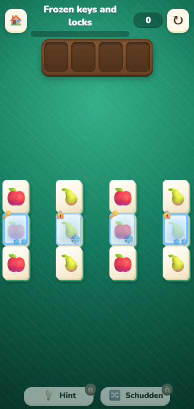
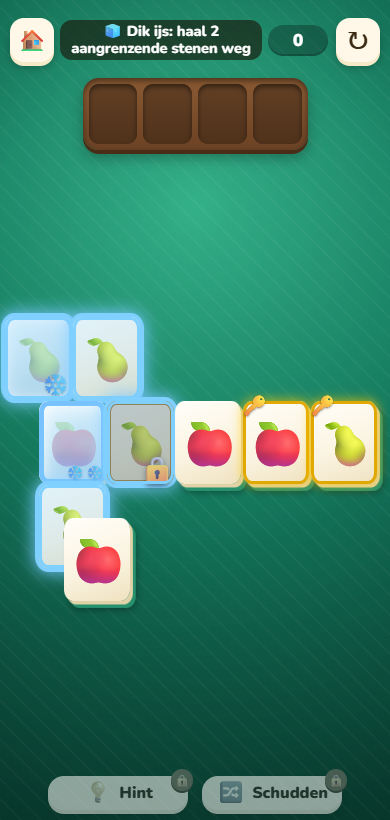

# TASK 13 — frozen markers and thaw hints

Prepared 2026-11-13 on `wip/codex-ui-markers`, in its own worktree. Base: local
`wip/cc-builder-loop` at `3787496bff592b3a2ad4b87227a0f9f075176ce9`, a descendant of
the required `6d6934aa`. The clock-badge containment fix and its `t_hard.js` test are retained.

## Changes

| File / line | Change |
| --- | --- |
| [specials.js:121](../../../source/www/js/specials.js#L121) | Keep `obKind()`'s existing ice-before-lock-before-key return values. Extract the independent key/lock role to `obMarker()`. Shared `obHTML()` / `paintOb()` add a `data-marker` badge only when ice and a key/lock coexist. |
| [board.js:169](../../../source/www/js/board.js#L169), [214](../../../source/www/js/board.js#L214) | Use the same overlay markup for initial batch drawing and subsequent decoration, including thawing, unlocking and redraws. |
| [style.css:618](../../../source/www/style.css#L618) | Frozen keys and locks have a top-left key/lock badge, above the ice tint and separate from the lower snowflakes. Existing plain key, lock, ice and thick-ice styles remain in use. |
| [specials.js:186](../../../source/www/js/specials.js#L186) | Frozen-tile taps apply the existing timed `obhint` effect to every alive ice-neighbour, removing only the takeability filter. |
| [style.css:634](../../../source/www/style.css#L634) | Add an inset cyan rim and tint to `obhint`, visible on the exposed portion of a covered tile. Explicit opacity keeps it visible with free-tile highlighting disabled. Hinted tiles keep their layer and expire as before. |
| [coach.js:71](../../../source/www/js/coach.js#L71), [191](../../../source/www/js/coach.js#L191) | Coach films use the same combined badges. Their ice-first classification and simulation rules are unchanged. |

`canTake`, `frozen`, `lockedT`, obstacle calculations, board data, bots, saves and replay formats
are unchanged. The only hint-selection change is which neighbours are visually marked.

## Caller / viewer review

- All three game `obKind()` callers were checked: `decorate()` and `renderBoard()` draw the
  extra badge, and the automatic-finish guard at `board.js:594` keeps exactly its prior truthiness.
- `czObKind()` still returns its previous classification. Coach captions at `coach.js:279`
  therefore retain their current behaviour. Coach film painting separately draws the key/lock badge.
- Static lesson badges (`lzTile()` / `.lz-badge`) are unchanged. Existing lesson and coach tests
  cover phone sizes, themes, languages, animation and isolation from the actual game.
- The dashboard SVG viewer (`source/site/dash/watch.js:105–121`) already draws ice and a key/lock
  independently. No production dashboard change was necessary; a new browser regression verifies
  a recorded frozen key and lock, then seeks to their thawed state.
- Recordings retain their existing obstacle state. The coach replay regression exercises actual
  neighbour takes through thick ice, thin ice and the remaining key badge.

## Screenshots

Captured from fixed offline fixtures using the real board renderer; these are not changed levels.
The first image shows thick-ice key, thin-ice lock, thin-ice key and thick-ice lock from left to right.



The second image shows a tapped frozen tile and its alive thaw neighbours: a free tile, a frozen
tile, a locked and side-blocked tile, and a partly covered tile at the lower left. The upper tile
keeps covering the hinted tile; only its exposed part lights up. Free-tile highlighting is disabled.



## Tests and verification

Four new Playwright tests:

1. [t_ui_markers.js:27](../../../source/tests/t_ui_markers.js#L27): both roles for `ice` and `ice2`,
   actual CSS badge contents, unchanged takeability and `obKind()`, decoration, landscape redraw,
   thick-to-thin cracking, thawing, unlocking while frozen and overlay removal.
2. [t_ui_markers.js:64](../../../source/tests/t_ui_markers.js#L64): a real pointer tap marks all
   alive thaw neighbours, including covered, side-blocked, locked and frozen neighbours; excludes
   a dead neighbour and non-neighbours; preserves board/rule/move/tray state; checks the exposed
   highlighted part with highlighting disabled and checks expiry.
3. [t_ui_markers.js:95](../../../source/tests/t_ui_markers.js#L95): a coach replay displays both
   badges and thaws the key through actual neighbouring take actions.
4. [t_dash_watch.js:17](../../../source/tests/t_dash_watch.js#L17): the dashboard recording viewer
   displays both badges before thaw, and only lock/key after seeking to thaw.

Final targeted run: **4/4 passed** (`node source/tests/run.js 'ui markers'`), including screenshot
regeneration from the final files. See [targeted log](targeted-suite.log).

Full offline suite against the final files: **149/150 passed in 417 seconds**. All four new tests
passed. See [full-suite log](offline-suite-final.log). The preceding complete run passed **150/150
in 373 seconds**; the last run was repeated after the inset-hint opacity fix and its extra assertion.

Untouched-base full-suite comparison: **146/146 passed in 363 seconds** on a detached worktree
at `3787496b`, using the same command and browser. See [baseline log](offline-baseline.log).

**Pre-existing intermittent failure, reproduced on untouched code:**
`win hearts: small English screen and foreground presence lifecycle`
(`source/tests/t_win_hearts.js:121`). Its popup-height assertion allows one pixel of difference.
The final full run measured `[320,509]` instead of `[320,514]`. A focused
`node source/tests/run.js win_hearts` rerun failed the same assertion on both this branch
(`[320,509]` vs `[320,501]`) and the untouched base (`[320,509]` vs `[320,479]`). Both focused
runs passed the other three heart tests. See [branch rerun](win-hearts-recheck.log) and
[untouched-base reproduction](win-hearts-baseline-recheck.log). No heart/popup code or its test
was changed. This task leaves that existing intermittent layout issue for separate work.

Environment:

```powershell
$env:NODE_PATH='C:\Users\den_k\Idea\OmasMahjong\oma-mahjong-main\source\tests\node_modules'
$env:CHROME='C:\Program Files\Google\Chrome\Application\chrome.exe'
node source/tests/run.js
```

To regenerate screenshots, set `UI_MARKERS_SHOTS` to an absolute output directory and run
`node source/tests/run.js 'ui markers'`. `git diff --check` passed.

## Release considerations

This is prepared work only: no release, merge to `main`, published-root edits or Firebase access.
The pre-existing popup-size failure above means the final full suite is not entirely green.
The branch deliberately includes the task's required unreleased builder-branch ancestry; any
future release must review that ancestry separately. Browser verification uses desktop Chrome
at phone and landscape sizes, plus the dashboard viewport. Physical Android/iPad rendering
has not been checked. The badge uses the existing emoji styling, so glyph appearance varies
with the device as it does for current markers. No migration or new Firebase rules are needed.
