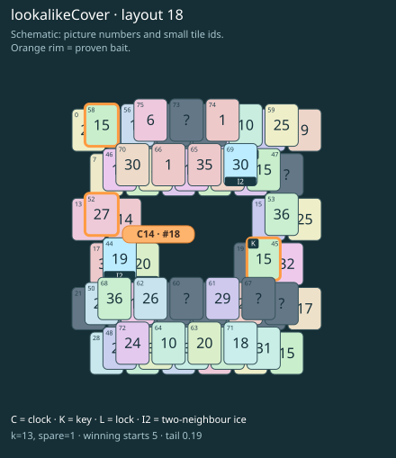

# lookalikeCover · layout 18

Reject the easy lookalike pair, thaw the real key roof, then open the lock and melt the separate clock roof.

| Fact | Value |
|---|---|
| Tiles / layout | 76 / 18 (frame) |
| Clock | tile 18: 13 shortest + 1 spare = 14 |
| Winning first moves | 5 proven; 0 unresolved out of 12 |
| Dearest unrelated temptation | 70: +0 clock moves |
| Tray on stored clock route | peak 3, run at 2+ = 6, visits to 3 = 5 |
| All-route tray bound | At least 2 waiting; {"cap1":"lose","cap2":"win"} |
| Tail greedy win | 0.19, 152/800, seed 977 |
| Face down | 25.0% |
| Close twins | 0 visible, 0 within four-copy pictures, 1 overall |
| UI dependency | none |

## Proven bait

- Tiles 52: +2 clock moves; dearer than the unrelated control.
- Tiles 45+58: +2 clock moves; dearer than the unrelated control.

## Each special matters

- lock 18: clockRoute; {"kind":"lock","tile":18,"by":"clockRoute","kWithout":6}
- ice 44: clockRoute; {"kind":"ice","tile":44,"by":"clockRoute","kWithout":9}
- ice 69: clockRoute; {"kind":"ice","tile":69,"by":"clockRoute","kWithout":9}

Easier: spare 2; obviousness dial 0. Harder: spare 1; obviousness dial 2 requires a greedy first bait.

[Board, strict solution and complete proof card](lookalikeCover-L18-s3-p1.json)

The tray trace describes the stored route. The capacity proof, when resolved, covers all game routes. Tail greedy win is the specified fixed-seed diagnostic, not a human rating.

## Chain and opening facts

Signature: `clock<lock; clock<cover:ice; keyA<cover:ice; keyPair<lookalikeChoice`. Chain links: 4. Layers: 3.

Two traps: {"kind":"hardChainAndMediumBait","hardLinks":4,"mediumLinks":2,"mediumEvidence":[{"bait":[52],"kind":"lonelyThaw","links":2,"thawHosts":[44],"twin":31,"twinCovers":[37,41,63,71,64]},{"bait":[45,58],"kind":"ordinaryKeyLookalike","links":2,"realKeys":[47,45],"opens":[18]}],"baits":[[52],[45,58]],"note":"Two separately priced bad decisions on one connected chain; no claim of additive sequential costs."}

Two frozen fronts: []

Obviousness dial 0: first route taps 45, 70; greedy sets {"rank":"freePair","tiles":[45,53,58,68]} / {"rank":"trayMatch","tiles":[58]}. Greedy prefix: false; ready free route pair: false; greedy-preferred baits: [[45,58]].

Tail waiting shares (before taps), 0 / 1 / 2 / 3: 0.317 / 0.492 / 0.175 / 0.016. Longest 2+ run: 2.
