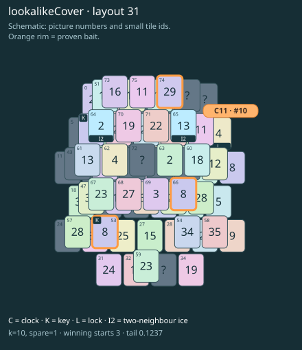

# lookalikeCover · layout 31

Reject the easy lookalike pair, thaw the real key roof, then open the lock and melt the separate clock roof.

| Fact | Value |
|---|---|
| Tiles / layout | 76 / 31 (oval · two islands) |
| Clock | tile 10: 10 shortest + 1 spare = 11 |
| Winning first moves | 3 proven; 0 unresolved out of 13 |
| Dearest unrelated temptation | 59+67: +2 clock moves |
| Tray on stored clock route | peak 3, run at 2+ = 9, visits to 3 = 4 |
| All-route tray bound | At least 3 waiting; {"cap1":"lose","cap2":"lose"} |
| Tail greedy win | 0.1237, 99/800, seed 977 |
| Face down | 25.0% |
| Close twins | 0 visible, 0 within four-copy pictures, 0 overall |
| UI dependency | none |

## Proven bait

- Tiles 74: +3 clock moves; dearer than the unrelated control.
- Tiles 53: +3 clock moves; dearer than the unrelated control.
- Tiles 53+66: +3 clock moves; dearer than the unrelated control.

## Each special matters

- lock 10: clockRoute; {"kind":"lock","tile":10,"by":"clockRoute","kWithout":7}
- ice 64: clockRoute; {"kind":"ice","tile":64,"by":"clockRoute","kWithout":9}
- ice 65: clockRoute; {"kind":"ice","tile":65,"by":"clockRoute","kWithout":8}

Easier: spare 2; obviousness dial 0. Harder: spare 1; obviousness dial 2 requires a greedy first bait.

[Board, strict solution and complete proof card](lookalikeCover-L31-s1-p1.json)

The tray trace describes the stored route. The capacity proof, when resolved, covers all game routes. Tail greedy win is the specified fixed-seed diagnostic, not a human rating.

## Chain and opening facts

Signature: `clock<lock; clock<cover:ice; keyA<cover:ice; keyPair<lookalikeChoice`. Chain links: 4. Layers: 3.

Two traps: {"kind":"hardChainAndMediumBait","hardLinks":4,"mediumLinks":2,"mediumEvidence":[{"bait":[74],"kind":"lonelyThaw","links":2,"thawHosts":[65],"twin":0,"twinCovers":[51,73]},{"bait":[53],"kind":"earlyKey","links":2,"partner":37,"partnerCovers":[64],"opens":[10]},{"bait":[53,66],"kind":"ordinaryKeyLookalike","links":2,"realKeys":[37,53],"opens":[10]}],"baits":[[74],[53],[53,66]],"note":"Two separately priced bad decisions on one connected chain; no claim of additive sequential costs."}

Two frozen fronts: []

Obviousness dial 0: first route taps 60, 61; greedy sets {"rank":"freePair","tiles":[53,59,66,67]} / {"rank":"freePair","tiles":[53,59,66,67]}. Greedy prefix: false; ready free route pair: false; greedy-preferred baits: [[53],[53,66]].

Tail waiting shares (before taps), 0 / 1 / 2 / 3: 0.318 / 0.485 / 0.182 / 0.015. Longest 2+ run: 3.
