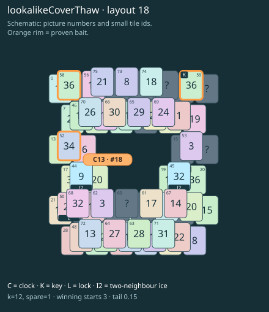

# lookalikeCoverThaw · layout 18

The wrong matching key picture leaves the thaw tile locked; first melt the true key roof, then the clock roof.

| Fact | Value |
|---|---|
| Tiles / layout | 76 / 18 (frame) |
| Clock | tile 18: 12 shortest + 1 spare = 13 |
| Winning first moves | 3 proven; 0 unresolved out of 12 |
| Dearest unrelated temptation | No candidates outside the mechanism |
| Tray on stored clock route | peak 3, run at 2+ = 9, visits to 3 = 4 |
| All-route tray bound | At least 3 waiting; {"cap1":"lose","cap2":"lose"} |
| Tail greedy win | 0.15, 120/800, seed 977 |
| Face down | 25.0% |
| Close twins | 0 visible, 0 within four-copy pictures, 0 overall |
| UI dependency | none |

## Proven bait

- Tiles 52: loss through clock 15; dearer than the unrelated control.
- Tiles 59: loss through clock 15; dearer than the unrelated control.
- Tiles 59+58: loss through clock 15; dearer than the unrelated control.

## Each special matters

- lock 50: clockRoute; {"kind":"lock","tile":50,"by":"clockRoute","kWithout":10}
- ice 44: clockRoute; {"kind":"ice","tile":44,"by":"clockRoute","kWithout":8}
- ice 45: clockRoute; {"kind":"ice","tile":45,"by":"clockRoute","kWithout":11}

Easier: spare 2; obviousness dial 0. Harder: spare 1; obviousness dial 2 requires a greedy first bait.

[Board, strict solution and complete proof card](lookalikeCoverThaw-L18-s4-p1.json)

The tray trace describes the stored route. The capacity proof, when resolved, covers all game routes. Tail greedy win is the specified fixed-seed diagnostic, not a human rating.

## Chain and opening facts

Signature: `clock<cover:ice; coverThaw<lock; keyA<cover:ice; keyPair<lookalikeChoice`. Chain links: 4. Layers: 3.

Two traps: {"kind":"hardChainAndMediumBait","hardLinks":4,"mediumLinks":2,"mediumEvidence":[{"bait":[52],"kind":"lonelyThaw","links":2,"thawHosts":[44],"twin":31,"twinCovers":[37,41,63,71,64]},{"bait":[59],"kind":"earlyKey","links":2,"partner":20,"partnerCovers":[45],"opens":[50]},{"bait":[59,58],"kind":"ordinaryKeyLookalike","links":2,"realKeys":[20,59],"opens":[50]}],"baits":[[52],[59],[59,58]],"note":"Two separately priced bad decisions on one connected chain; no claim of additive sequential costs."}

Two frozen fronts: []

Obviousness dial 0: first route taps 68, 62; greedy sets {"rank":"freePair","tiles":[58,59]} / {"rank":"freePair","tiles":[53,58,59,62]}. Greedy prefix: false; ready free route pair: false; greedy-preferred baits: [[59],[59,58]].

Tail waiting shares (before taps), 0 / 1 / 2 / 3: 0.391 / 0.484 / 0.109 / 0.016. Longest 2+ run: 3.
