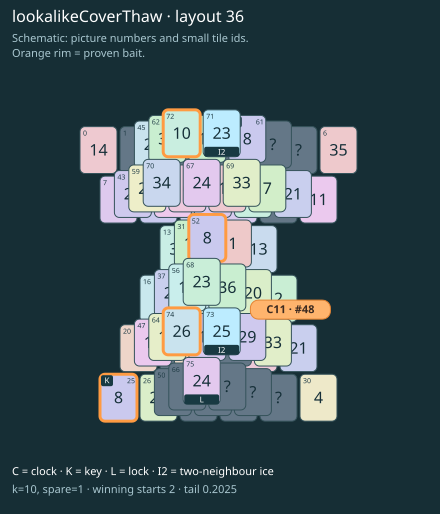

# lookalikeCoverThaw · layout 36

The wrong matching key picture leaves the thaw tile locked; first melt the true key roof, then the clock roof. Each of two frozen fronts has its own proven lonely-neighbour bait.

| Fact | Value |
|---|---|
| Tiles / layout | 76 / 36 (hourglass) |
| Clock | tile 48: 10 shortest + 1 spare = 11 |
| Winning first moves | 2 proven; 0 unresolved out of 10 |
| Dearest unrelated temptation | No candidates outside the mechanism |
| Tray on stored clock route | peak 3, run at 2+ = 5, visits to 3 = 3 |
| All-route tray bound | At least 3 waiting; {"cap1":"lose","cap2":"lose"} |
| Tail greedy win | 0.2025, 162/800, seed 977 |
| Face down | 25.0% |
| Close twins | 0 visible, 0 within four-copy pictures, 0 overall |
| UI dependency | none |

## Proven bait

- Tiles 74: loss through clock 13; dearer than the unrelated control.
- Tiles 72: loss through clock 13; dearer than the unrelated control.
- Tiles 25: loss through clock 13; dearer than the unrelated control.
- Tiles 25+52: loss through clock 13; dearer than the unrelated control.

## Each special matters

- lock 75: clockRoute; {"kind":"lock","tile":75,"by":"clockRoute","kWithout":8}
- ice 71: clockRoute; {"kind":"ice","tile":71,"by":"clockRoute","kWithout":9}
- ice 73: clockRoute; {"kind":"ice","tile":73,"by":"clockRoute","kWithout":3}

Easier: spare 2; obviousness dial 0. Harder: spare 1; obviousness dial 2 requires a greedy first bait.

[Board, strict solution and complete proof card](lookalikeCoverThaw-L36-s3-p1.json)

The tray trace describes the stored route. The capacity proof, when resolved, covers all game routes. Tail greedy win is the specified fixed-seed diagnostic, not a human rating.

## Chain and opening facts

Signature: `clock<cover:ice; coverThaw<lock; keyA<cover:ice; keyPair<lookalikeChoice`. Chain links: 4. Layers: 4.

Two traps: {"kind":"hardChainAndMediumBait","hardLinks":4,"mediumLinks":2,"mediumEvidence":[{"bait":[74],"kind":"lonelyThaw","links":2,"thawHosts":[73],"twin":45,"twinCovers":[62,72]},{"bait":[72],"kind":"lonelyThaw","links":2,"thawHosts":[71],"twin":36,"twinCovers":[53,58,69,67]},{"bait":[25],"kind":"earlyKey","links":2,"partner":61,"partnerCovers":[71],"opens":[75]},{"bait":[25,52],"kind":"ordinaryKeyLookalike","links":2,"realKeys":[61,25],"opens":[75]}],"baits":[[74],[72],[25],[25,52]],"note":"Two separately priced bad decisions on one connected chain; no claim of additive sequential costs."}

Two frozen fronts: [{"host":71,"lone":72,"twin":36},{"host":73,"lone":74,"twin":45}]

Obviousness dial 0: first route taps 68, 69; greedy sets {"rank":"freePair","tiles":[25,52]} / {"rank":"freePair","tiles":[25,52]}. Greedy prefix: false; ready free route pair: false; greedy-preferred baits: [[25],[25,52]].

Tail waiting shares (before taps), 0 / 1 / 2 / 3: 0.394 / 0.47 / 0.106 / 0.03. Longest 2+ run: 3.
