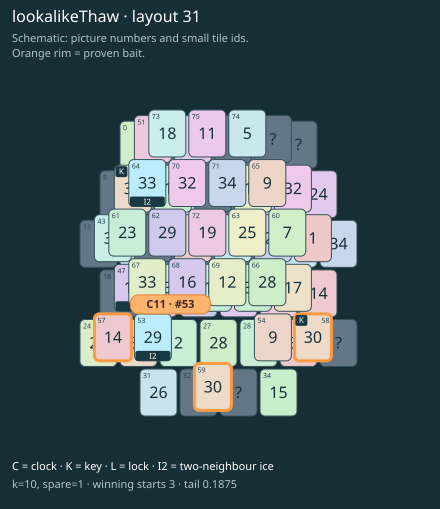

# lookalikeThaw · layout 31

A matching ordinary picture cannot replace the guarded key: save the true key pair to unlock the neighbour that thaws the clock.

| Fact | Value |
|---|---|
| Tiles / layout | 76 / 31 (oval · two islands) |
| Clock | tile 53: 10 shortest + 1 spare = 11 |
| Winning first moves | 3 proven; 0 unresolved out of 13 |
| Dearest unrelated temptation | 54+65: +2 clock moves |
| Tray on stored clock route | peak 3, run at 2+ = 9, visits to 3 = 4 |
| All-route tray bound | At least 3 waiting; {"cap1":"lose","cap2":"lose"} |
| Tail greedy win | 0.1875, 150/800, seed 977 |
| Face down | 25.0% |
| Close twins | 0 visible, 0 within four-copy pictures, 1 overall |
| UI dependency | none |

## Proven bait

- Tiles 57: loss through clock 13; dearer than the unrelated control.
- Tiles 58: loss through clock 13; dearer than the unrelated control.
- Tiles 58+59: loss through clock 13; dearer than the unrelated control.

## Each special matters

- lock 47: clockRoute; {"kind":"lock","tile":47,"by":"clockRoute","kWithout":7}
- ice 53: clockRoute; {"kind":"ice","tile":53,"by":"clockRoute","kWithout":1}
- ice 64: clockRoute; {"kind":"ice","tile":64,"by":"clockRoute","kWithout":7}

Easier: spare 2; obviousness dial 0. Harder: spare 1; obviousness dial 2 requires a greedy first bait.

[Board, strict solution and complete proof card](lookalikeThaw-L31-s1-p1.json)

The tray trace describes the stored route. The capacity proof, when resolved, covers all game routes. Tail greedy win is the specified fixed-seed diagnostic, not a human rating.

## Chain and opening facts

Signature: `clock<ice; thaw<lock; keyA<cover:ice; keyPair<lookalikeChoice`. Chain links: 4. Layers: 3.

Two traps: {"kind":"hardChainAndMediumBait","hardLinks":4,"mediumLinks":2,"mediumEvidence":[{"bait":[57],"kind":"lonelyThaw","links":2,"thawHosts":[53],"twin":23,"twinCovers":[48,66]},{"bait":[58],"kind":"earlyKey","links":2,"partner":37,"partnerCovers":[64],"opens":[47]},{"bait":[58,59],"kind":"ordinaryKeyLookalike","links":2,"realKeys":[37,58],"opens":[47]}],"baits":[[57],[58],[58,59]],"note":"Two separately priced bad decisions on one connected chain; no claim of additive sequential costs."}

Two frozen fronts: []

Obviousness dial 0: first route taps 61, 62; greedy sets {"rank":"freePair","tiles":[54,58,59,65]} / {"rank":"freePair","tiles":[54,58,59,65]}. Greedy prefix: false; ready free route pair: false; greedy-preferred baits: [[58],[58,59]].

Tail waiting shares (before taps), 0 / 1 / 2 / 3: 0.394 / 0.485 / 0.106 / 0.015. Longest 2+ run: 3.
