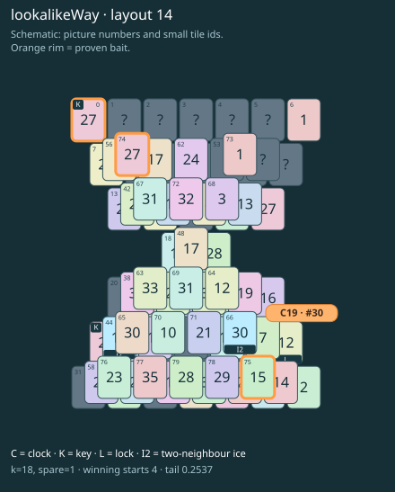

# lookalikeWay · layout 14

The matching lookalike spends the wrong key; thaw the way to the true partner before the separate clock roof.

| Fact | Value |
|---|---|
| Tiles / layout | 80 / 14 (hourglass) |
| Clock | tile 30: 18 shortest + 1 spare = 19 |
| Winning first moves | 4 proven; 0 unresolved out of 12 |
| Dearest unrelated temptation | 6+73: loss through clock 19 |
| Tray on stored clock route | peak 3, run at 2+ = 17, visits to 3 = 8 |
| All-route tray bound | At least 3 waiting; {"cap1":"lose","cap2":"lose"} |
| Tail greedy win | 0.2537, 203/800, seed 977 |
| Face down | 25.0% |
| Close twins | 0 visible, 0 within four-copy pictures, 2 overall |
| UI dependency | none |

## Proven bait

- Tiles 75: loss through clock 19; no dearer than the unrelated control.
- Tiles 0: loss through clock 19; no dearer than the unrelated control.
- Tiles 0+74: loss through clock 19; no dearer than the unrelated control.

## Each special matters

- lock 30: clockRoute; {"kind":"lock","tile":30,"by":"clockRoute","kWithout":16}
- ice 44: clockRoute; {"kind":"ice","tile":44,"by":"clockRoute","kWithout":10}
- ice 66: clockRoute; {"kind":"ice","tile":66,"by":"clockRoute","kWithout":13}

Easier: spare 2; obviousness dial 0. Harder: spare 1; obviousness dial 2 requires a greedy first bait.

[Board, strict solution and complete proof card](lookalikeWay-L14-s3-p1.json)

The tray trace describes the stored route. The capacity proof, when resolved, covers all game routes. Tail greedy win is the specified fixed-seed diagnostic, not a human rating.

## Chain and opening facts

Signature: `clock<lock; clock<cover:ice; keyA<way:ice; keyPair<lookalikeChoice`. Chain links: 4. Layers: 3.

Two traps: {"kind":"hardChainAndMediumBait","hardLinks":4,"mediumLinks":2,"mediumEvidence":[{"bait":[75],"kind":"lonelyThaw","links":2,"thawHosts":[66],"twin":32,"twinCovers":[54,58,76,77]},{"bait":[0],"kind":"earlyKey","links":2,"partner":25,"partnerCovers":[44,65],"opens":[30]},{"bait":[0,74],"kind":"ordinaryKeyLookalike","links":2,"realKeys":[25,0],"opens":[30]}],"baits":[[75],[0],[0,74]],"note":"Two separately priced bad decisions on one connected chain; no claim of additive sequential costs."}

Two frozen fronts: []

Obviousness dial 0: first route taps 65, 63; greedy sets {"rank":"freePair","tiles":[0,6,73,74]} / {"rank":"freePair","tiles":[0,6,73,74]}. Greedy prefix: false; ready free route pair: false; greedy-preferred baits: [[0],[0,74]].

Tail waiting shares (before taps), 0 / 1 / 2 / 3: 0.387 / 0.484 / 0.113 / 0.016. Longest 2+ run: 3.
