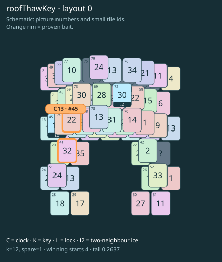

# roofThawKey · layout 0

The roof key uncovers the clock but cannot thaw it: first reach its partner through ice, then unlock the thaw neighbour.

| Fact | Value |
|---|---|
| Tiles / layout | 80 / 0 (arch) |
| Clock | tile 45: 12 shortest + 1 spare = 13 |
| Winning first moves | 4 proven; 0 unresolved out of 15 |
| Dearest unrelated temptation | No candidates outside the mechanism |
| Tray on stored clock route | peak 3, run at 2+ = 11, visits to 3 = 5 |
| All-route tray bound | At least 3 waiting; {"cap1":"lose","cap2":"lose"} |
| Tail greedy win | 0.2637, 211/800, seed 977 |
| Face down | 25.0% |
| Close twins | 0 visible, 0 within four-copy pictures, 0 overall |
| UI dependency | none |

## Proven bait

- Tiles 41: loss through clock 15; dearer than the unrelated control.
- Tiles 71: +3 clock moves; dearer than the unrelated control.

## Each special matters

- lock 43: baitDefused; {"kind":"lock","tile":43,"by":"baitDefused","bait":[71],"winsAt":13}
- ice 45: clockRoute; {"kind":"ice","tile":45,"by":"clockRoute","kWithout":8}
- ice 72: clockRoute; {"kind":"ice","tile":72,"by":"clockRoute","kWithout":7}

Easier: spare 2; obviousness dial 0. Harder: spare 1; obviousness dial 2 requires a greedy first bait.

[Board, strict solution and complete proof card](roofThawKey-L0-s7-p1.json)

The tray trace describes the stored route. The capacity proof, when resolved, covers all game routes. Tail greedy win is the specified fixed-seed diagnostic, not a human rating.

## Chain and opening facts

Signature: `clock<ice; thaw<lock; keyA<cover:ice; keyB<clockRoof`. Chain links: 4. Layers: 5.

Two traps: {"kind":"hardChainAndMediumBait","hardLinks":4,"mediumLinks":2,"mediumEvidence":[{"bait":[41],"kind":"lonelyThaw","links":2,"thawHosts":[45],"twin":0,"twinCovers":[49,66,77]},{"bait":[71],"kind":"earlyKey","links":2,"partner":58,"partnerCovers":[72],"opens":[43]}],"baits":[[41],[71]],"note":"Two separately priced bad decisions on one connected chain; no claim of additive sequential costs."}

Two frozen fronts: []

Obviousness dial 0: first route taps 70, 73; greedy sets {"rank":"freePair","tiles":[51,79]} / {"rank":"freePair","tiles":[51,79]}. Greedy prefix: false; ready free route pair: false; greedy-preferred baits: [].

Tail waiting shares (before taps), 0 / 1 / 2 / 3: 0.368 / 0.485 / 0.132 / 0.015. Longest 2+ run: 3.
