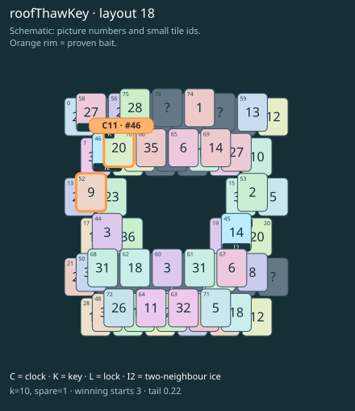

# roofThawKey · layout 18

The roof key uncovers the clock but cannot thaw it: first reach its partner through ice, then unlock the thaw neighbour.

| Fact | Value |
|---|---|
| Tiles / layout | 76 / 18 (frame) |
| Clock | tile 46: 10 shortest + 1 spare = 11 |
| Winning first moves | 3 proven; 0 unresolved out of 12 |
| Dearest unrelated temptation | 69: +0 clock moves |
| Tray on stored clock route | peak 3, run at 2+ = 7, visits to 3 = 3 |
| All-route tray bound | At least 3 waiting; {"cap1":"lose","cap2":"lose"} |
| Tail greedy win | 0.22, 176/800, seed 977 |
| Face down | 25.0% |
| Close twins | 0 visible, 0 within four-copy pictures, 0 overall |
| UI dependency | none |

## Proven bait

- Tiles 52: loss through clock 13; dearer than the unrelated control.
- Tiles 70: loss through clock 13; dearer than the unrelated control.

## Each special matters

- lock 58: clockRoute; {"kind":"lock","tile":58,"by":"clockRoute","kWithout":7}
- ice 45: clockRoute; {"kind":"ice","tile":45,"by":"clockRoute","kWithout":5}
- ice 46: clockRoute; {"kind":"ice","tile":46,"by":"clockRoute","kWithout":2}

Easier: spare 2; obviousness dial 0. Harder: spare 1; obviousness dial 2 requires a greedy first bait.

[Board, strict solution and complete proof card](roofThawKey-L18-s4-p1.json)

The tray trace describes the stored route. The capacity proof, when resolved, covers all game routes. Tail greedy win is the specified fixed-seed diagnostic, not a human rating.

## Chain and opening facts

Signature: `clock<ice; thaw<lock; keyA<cover:ice; keyB<clockRoof`. Chain links: 4. Layers: 3.

Two traps: {"kind":"hardChainAndMediumBait","hardLinks":4,"mediumLinks":2,"mediumEvidence":[{"bait":[52],"kind":"lonelyThaw","links":2,"thawHosts":[46],"twin":32,"twinCovers":[41,49,71,63]},{"bait":[70],"kind":"earlyKey","links":2,"partner":20,"partnerCovers":[45],"opens":[58]}],"baits":[[52],[70]],"note":"Two separately priced bad decisions on one connected chain; no claim of additive sequential costs."}

Two frozen fronts: []

Obviousness dial 0: first route taps 69, 67; greedy sets {"rank":"specialProgress","tiles":[52,53,70]} / {"rank":"freePair","tiles":[65,67]}. Greedy prefix: false; ready free route pair: false; greedy-preferred baits: [[52],[70]].

Tail waiting shares (before taps), 0 / 1 / 2 / 3: 0.333 / 0.5 / 0.167 / 0. Longest 2+ run: 1.
