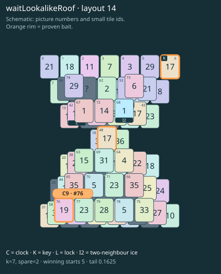

# waitLookalikeRoof · layout 14

The free clock and the easy matching key lookalike both spend the space needed to thaw the real key roof and open the clock twin.

| Fact | Value |
|---|---|
| Tiles / layout | 80 / 14 (hourglass) |
| Clock | tile 76: 7 shortest + 2 spare = 9 |
| Winning first moves | 5 proven; 0 unresolved out of 12 |
| Dearest unrelated temptation | 65+66: +2 clock moves |
| Tray on stored clock route | peak 3, run at 2+ = 6, visits to 3 = 3 |
| All-route tray bound | Unresolved: {} |
| Tail greedy win | 0.1625, 130/800, seed 977 |
| Face down | 25.0% |
| Close twins | 0 visible, 0 within four-copy pictures, 0 overall |
| UI dependency | none |

## Proven bait

- Tiles 6: loss through clock 10; dearer than the unrelated control.
- Tiles 76: loss through clock 10; dearer than the unrelated control.
- Tiles 6+48: loss through clock 10; dearer than the unrelated control.

## Each special matters

- lock 42: clockRoute; {"kind":"lock","tile":42,"by":"clockRoute","kWithout":1}
- ice 68: clockRoute; {"kind":"ice","tile":68,"by":"clockRoute","kWithout":1}

Easier: spare 2; obviousness dial 0. Harder: spare 1; obviousness dial 2 requires a greedy first bait.

[Board, strict solution and complete proof card](waitLookalikeRoof-L14-s5-p2.json)

The tray trace describes the stored route. The capacity proof, when resolved, covers all game routes. Tail greedy win is the specified fixed-seed diagnostic, not a human rating.

## Chain and opening facts

Signature: `clock<lock; keyA<cover:ice; clock<waitForTwin; keyPair<lookalikeChoice`. Chain links: 4. Layers: 3.

Two traps: {"kind":"hardChainAndMediumBait","hardLinks":4,"mediumLinks":2,"mediumEvidence":[{"bait":[6],"kind":"earlyKey","links":2,"partner":43,"partnerCovers":[68],"opens":[42]},{"bait":[76],"kind":"waitingClock","links":2,"twin":42,"twinCovers":[67]},{"bait":[6,48],"kind":"ordinaryKeyLookalike","links":2,"realKeys":[43,6],"opens":[42]}],"baits":[[6],[76],[6,48]],"note":"Two separately priced bad decisions on one connected chain; no claim of additive sequential costs."}

Two frozen fronts: []

Obviousness dial 0: first route taps 67, 72; greedy sets {"rank":"freePair","tiles":[6,48,65,66]} / {"rank":"freePair","tiles":[6,48,65,66]}. Greedy prefix: false; ready free route pair: false; greedy-preferred baits: [[6],[6,48]].

Tail waiting shares (before taps), 0 / 1 / 2 / 3: 0.37 / 0.493 / 0.123 / 0.014. Longest 2+ run: 2.
