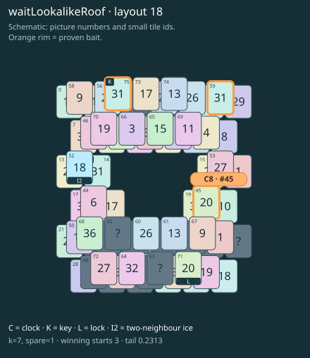

# waitLookalikeRoof · layout 18

The free clock and the easy matching key lookalike both spend the space needed to thaw the real key roof and open the clock twin.

| Fact | Value |
|---|---|
| Tiles / layout | 76 / 18 (frame) |
| Clock | tile 45: 7 shortest + 1 spare = 8 |
| Winning first moves | 3 proven; 0 unresolved out of 12 |
| Dearest unrelated temptation | 53+72: +2 clock moves |
| Tray on stored clock route | peak 3, run at 2+ = 4, visits to 3 = 2 |
| All-route tray bound | At least 3 waiting; {"cap1":"lose","cap2":"lose"} |
| Tail greedy win | 0.2313, 185/800, seed 977 |
| Face down | 25.0% |
| Close twins | 0 visible, 0 within four-copy pictures, 0 overall |
| UI dependency | none |

## Proven bait

- Tiles 45: loss through clock 10; dearer than the unrelated control.
- Tiles 75+59: loss through clock 10; dearer than the unrelated control.

## Each special matters

- lock 71: clockRoute; {"kind":"lock","tile":71,"by":"clockRoute","kWithout":1}
- ice 52: clockRoute; {"kind":"ice","tile":52,"by":"clockRoute","kWithout":1}

Easier: spare 2; obviousness dial 0. Harder: spare 1; obviousness dial 2 requires a greedy first bait.

[Board, strict solution and complete proof card](waitLookalikeRoof-L18-s5-p1.json)

The tray trace describes the stored route. The capacity proof, when resolved, covers all game routes. Tail greedy win is the specified fixed-seed diagnostic, not a human rating.

## Chain and opening facts

Signature: `clock<lock; keyA<cover:ice; clock<waitForTwin; keyPair<lookalikeChoice`. Chain links: 4. Layers: 3.

Two traps: {"kind":"hardChainAndMediumBait","hardLinks":4,"mediumLinks":2,"mediumEvidence":[{"bait":[45],"kind":"waitingClock","links":2,"twin":71,"twinCovers":[]},{"bait":[75,59],"kind":"ordinaryKeyLookalike","links":2,"realKeys":[14,75],"opens":[71]}],"baits":[[45],[75,59]],"note":"Two separately priced bad decisions on one connected chain; no claim of additive sequential costs."}

Two frozen fronts: []

Obviousness dial 0: first route taps 70, 44; greedy sets {"rank":"freePair","tiles":[53,58,59,67,72,75]} / {"rank":"freePair","tiles":[44,46,53,58,59,67,72,75]}. Greedy prefix: false; ready free route pair: false; greedy-preferred baits: [[75,59]].

Tail waiting shares (before taps), 0 / 1 / 2 / 3: 0.362 / 0.493 / 0.13 / 0.014. Longest 2+ run: 2.
