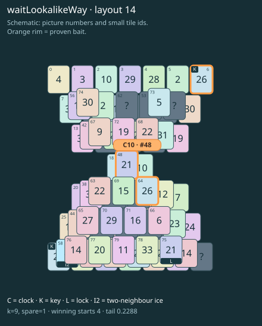

# waitLookalikeWay · layout 14

Leave the clock exposed and refuse the ordinary key lookalike; the icy way to the true key must be prepared before either can be paired safely.

| Fact | Value |
|---|---|
| Tiles / layout | 80 / 14 (hourglass) |
| Clock | tile 48: 9 shortest + 1 spare = 10 |
| Winning first moves | 4 proven; 0 unresolved out of 12 |
| Dearest unrelated temptation | 63+68: +2 clock moves |
| Tray on stored clock route | peak 3, run at 2+ = 8, visits to 3 = 4 |
| All-route tray bound | At least 3 waiting; {"cap1":"lose","cap2":"lose"} |
| Tail greedy win | 0.2288, 183/800, seed 977 |
| Face down | 25.0% |
| Close twins | 0 visible, 0 within four-copy pictures, 0 overall |
| UI dependency | none |

## Proven bait

- Tiles 6: loss through clock 12; dearer than the unrelated control.
- Tiles 48: loss through clock 12; dearer than the unrelated control.
- Tiles 6+64: loss through clock 12; dearer than the unrelated control.

## Each special matters

- lock 75: clockRoute; {"kind":"lock","tile":75,"by":"clockRoute","kWithout":1}
- ice 58: clockRoute; {"kind":"ice","tile":58,"by":"clockRoute","kWithout":1}

Easier: spare 2; obviousness dial 0. Harder: spare 1; obviousness dial 2 requires a greedy first bait.

[Board, strict solution and complete proof card](waitLookalikeWay-L14-s5-p1.json)

The tray trace describes the stored route. The capacity proof, when resolved, covers all game routes. Tail greedy win is the specified fixed-seed diagnostic, not a human rating.

## Chain and opening facts

Signature: `clock<lock; keyA<way:ice; clock<waitForTwin; keyPair<lookalikeChoice`. Chain links: 4. Layers: 3.

Two traps: {"kind":"hardChainAndMediumBait","hardLinks":4,"mediumLinks":2,"mediumEvidence":[{"bait":[6],"kind":"earlyKey","links":2,"partner":31,"partnerCovers":[58,76],"opens":[75]},{"bait":[48],"kind":"waitingClock","links":2,"twin":75,"twinCovers":[]},{"bait":[6,64],"kind":"ordinaryKeyLookalike","links":2,"realKeys":[31,6],"opens":[75]}],"baits":[[6],[48],[6,64]],"note":"Two separately priced bad decisions on one connected chain; no claim of additive sequential costs."}

Two frozen fronts: []

Obviousness dial 0: first route taps 65, 44; greedy sets {"rank":"freePair","tiles":[6,63,64,68]} / {"rank":"freePair","tiles":[6,44,63,64,67,68]}. Greedy prefix: false; ready free route pair: false; greedy-preferred baits: [[6],[6,64]].

Tail waiting shares (before taps), 0 / 1 / 2 / 3: 0.324 / 0.493 / 0.169 / 0.014. Longest 2+ run: 2.
