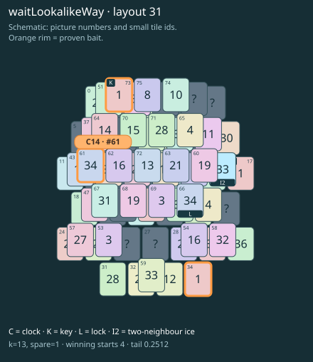

# waitLookalikeWay · layout 31

Leave the clock exposed and refuse the ordinary key lookalike; the icy way to the true key must be prepared before either can be paired safely.

| Fact | Value |
|---|---|
| Tiles / layout | 76 / 31 (oval · two islands) |
| Clock | tile 61: 13 shortest + 1 spare = 14 |
| Winning first moves | 4 proven; 0 unresolved out of 14 |
| Dearest unrelated temptation | No candidates outside the mechanism |
| Tray on stored clock route | peak 3, run at 2+ = 12, visits to 3 = 6 |
| All-route tray bound | At least 3 waiting; {"cap1":"lose","cap2":"lose"} |
| Tail greedy win | 0.2512, 201/800, seed 977 |
| Face down | 25.0% |
| Close twins | 0 visible, 0 within four-copy pictures, 0 overall |
| UI dependency | none |

## Proven bait

- Tiles 73: loss through clock 16; dearer than the unrelated control.
- Tiles 61: loss through clock 16; dearer than the unrelated control.
- Tiles 73+34: loss through clock 16; dearer than the unrelated control.

## Each special matters

- lock 66: clockRoute; {"kind":"lock","tile":66,"by":"clockRoute","kWithout":1}
- ice 44: clockRoute; {"kind":"ice","tile":44,"by":"clockRoute","kWithout":1}

Easier: spare 2; obviousness dial 0. Harder: spare 1; obviousness dial 2 requires a greedy first bait.

[Board, strict solution and complete proof card](waitLookalikeWay-L31-s5-p1.json)

The tray trace describes the stored route. The capacity proof, when resolved, covers all game routes. Tail greedy win is the specified fixed-seed diagnostic, not a human rating.

## Chain and opening facts

Signature: `clock<lock; keyA<way:ice; clock<waitForTwin; keyPair<lookalikeChoice`. Chain links: 4. Layers: 3.

Two traps: {"kind":"hardChainAndMediumBait","hardLinks":4,"mediumLinks":2,"mediumEvidence":[{"bait":[73],"kind":"earlyKey","links":2,"partner":17,"partnerCovers":[44,60],"opens":[66]},{"bait":[61],"kind":"waitingClock","links":2,"twin":66,"twinCovers":[]},{"bait":[73,34],"kind":"ordinaryKeyLookalike","links":2,"realKeys":[17,73],"opens":[66]}],"baits":[[73],[61],[73,34]],"note":"Two separately priced bad decisions on one connected chain; no claim of additive sequential costs."}

Two frozen fronts: []

Obviousness dial 0: first route taps 65, 71; greedy sets {"rank":"freePair","tiles":[34,73]} / {"rank":"freePair","tiles":[31,34,71,73]}. Greedy prefix: false; ready free route pair: false; greedy-preferred baits: [[73],[73,34]].

Tail waiting shares (before taps), 0 / 1 / 2 / 3: 0.349 / 0.492 / 0.143 / 0.016. Longest 2+ run: 2.
