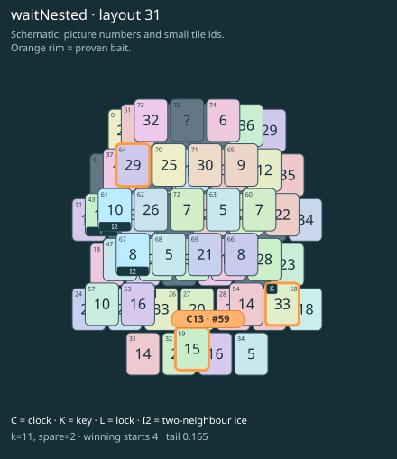

# waitNested · layout 31

The free clock is only the end of the route: keys open its twin, but two nested melts still need the tray first.

| Fact | Value |
|---|---|
| Tiles / layout | 76 / 31 (oval · two islands) |
| Clock | tile 59: 11 shortest + 2 spare = 13 |
| Winning first moves | 4 proven; 0 unresolved out of 13 |
| Dearest unrelated temptation | 57: loss through clock 14 |
| Tray on stored clock route | peak 3, run at 2+ = 10, visits to 3 = 5 |
| All-route tray bound | Unresolved: {} |
| Tail greedy win | 0.165, 132/800, seed 977 |
| Face down | 25.0% |
| Close twins | 0 visible, 0 within four-copy pictures, 0 overall |
| UI dependency | none |

## Proven bait

- Tiles 64: loss through clock 14; no dearer than the unrelated control.
- Tiles 58: loss through clock 14; no dearer than the unrelated control.
- Tiles 59: loss through clock 14; no dearer than the unrelated control.

## Each special matters

- lock 43: clockRoute; {"kind":"lock","tile":43,"by":"clockRoute","kWithout":9}
- ice 61: clockRoute; {"kind":"ice","tile":61,"by":"clockRoute","kWithout":1}
- ice 67: clockRoute; {"kind":"ice","tile":67,"by":"clockRoute","kWithout":1}

Easier: spare 2; obviousness dial 0. Harder: spare 1; obviousness dial 2 requires a greedy first bait.

[Board, strict solution and complete proof card](waitNested-L31-s2-p2.json)

The tray trace describes the stored route. The capacity proof, when resolved, covers all game routes. Tail greedy win is the specified fixed-seed diagnostic, not a human rating.

## Chain and opening facts

Signature: `clock<lock; clock<cover:ice; coverThaw<ice; clock<waitForTwin`. Chain links: 4. Layers: 3.

Two traps: {"kind":"hardChainAndMediumBait","hardLinks":4,"mediumLinks":2,"mediumEvidence":[{"bait":[64],"kind":"lonelyThaw","links":2,"thawHosts":[61],"twin":4,"twinCovers":[52,74]},{"bait":[58],"kind":"earlyKey","links":2,"partner":26,"partnerCovers":[53],"opens":[43]},{"bait":[59],"kind":"waitingClock","links":2,"twin":43,"twinCovers":[61]}],"baits":[[64],[58],[59]],"note":"Two separately priced bad decisions on one connected chain; no claim of additive sequential costs."}

Two frozen fronts: []

Obviousness dial 0: first route taps 60, 66; greedy sets {"rank":"freePair","tiles":[31,54]} / {"rank":"freePair","tiles":[31,34,54,63]}. Greedy prefix: false; ready free route pair: false; greedy-preferred baits: [].

Tail waiting shares (before taps), 0 / 1 / 2 / 3: 0.354 / 0.462 / 0.138 / 0.046. Longest 2+ run: 6.
