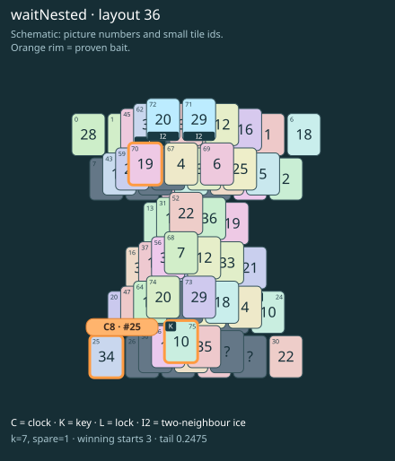

# waitNested · layout 36

The free clock is only the end of the route: keys open its twin, but two nested melts still need the tray first.

| Fact | Value |
|---|---|
| Tiles / layout | 76 / 36 (hourglass) |
| Clock | tile 25: 7 shortest + 1 spare = 8 |
| Winning first moves | 3 proven; 0 unresolved out of 11 |
| Dearest unrelated temptation | 30+52: +2 clock moves |
| Tray on stored clock route | peak 3, run at 2+ = 6, visits to 3 = 3 |
| All-route tray bound | At least 3 waiting; {"cap1":"lose","cap2":"lose"} |
| Tail greedy win | 0.2475, 198/800, seed 977 |
| Face down | 25.0% |
| Close twins | 0 visible, 0 within four-copy pictures, 0 overall |
| UI dependency | none |

## Proven bait

- Tiles 70: +2 clock moves; no dearer than the unrelated control.
- Tiles 75: +2 clock moves; no dearer than the unrelated control.
- Tiles 25: loss through clock 10; dearer than the unrelated control.

## Each special matters

- lock 62: clockRoute; {"kind":"lock","tile":62,"by":"clockRoute","kWithout":5}
- ice 71: clockRoute; {"kind":"ice","tile":71,"by":"clockRoute","kWithout":1}
- ice 72: clockRoute; {"kind":"ice","tile":72,"by":"clockRoute","kWithout":1}

Easier: spare 2; obviousness dial 0. Harder: spare 1; obviousness dial 2 requires a greedy first bait.

[Board, strict solution and complete proof card](waitNested-L36-s3-p1.json)

The tray trace describes the stored route. The capacity proof, when resolved, covers all game routes. Tail greedy win is the specified fixed-seed diagnostic, not a human rating.

## Chain and opening facts

Signature: `clock<lock; clock<cover:ice; coverThaw<ice; clock<waitForTwin`. Chain links: 4. Layers: 4.

Two traps: {"kind":"hardChainAndMediumBait","hardLinks":4,"mediumLinks":2,"mediumEvidence":[{"bait":[70],"kind":"lonelyThaw","links":2,"thawHosts":[72],"twin":15,"twinCovers":[32,52]},{"bait":[75],"kind":"earlyKey","links":2,"partner":24,"partnerCovers":[48,63,73],"opens":[62]},{"bait":[25],"kind":"waitingClock","links":2,"twin":62,"twinCovers":[72]}],"baits":[[70],[75],[25]],"note":"Two separately priced bad decisions on one connected chain; no claim of additive sequential costs."}

Two frozen fronts: []

Obviousness dial 0: first route taps 69, 67; greedy sets {"rank":"freePair","tiles":[30,52]} / {"rank":"freePair","tiles":[30,52]}. Greedy prefix: false; ready free route pair: false; greedy-preferred baits: [].

Tail waiting shares (before taps), 0 / 1 / 2 / 3: 0.377 / 0.464 / 0.116 / 0.043. Longest 2+ run: 6.
