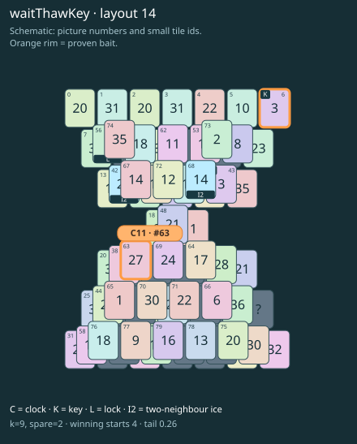

# waitThawKey · layout 14

Prepare the frozen key roof, use both keys to open the thaw tile, and melt the clock picture before collecting its exposed clock twin.

| Fact | Value |
|---|---|
| Tiles / layout | 80 / 14 (hourglass) |
| Clock | tile 63: 9 shortest + 2 spare = 11 |
| Winning first moves | 4 proven; 0 unresolved out of 12 |
| Dearest unrelated temptation | 0+75: +2 clock moves |
| Tray on stored clock route | peak 3, run at 2+ = 8, visits to 3 = 4 |
| All-route tray bound | Unresolved: {} |
| Tail greedy win | 0.26, 208/800, seed 977 |
| Face down | 25.0% |
| Close twins | 0 visible, 0 within four-copy pictures, 0 overall |
| UI dependency | none |

## Proven bait

- Tiles 6: loss through clock 12; dearer than the unrelated control.
- Tiles 63: loss through clock 12; dearer than the unrelated control.

## Each special matters

- lock 56: clockRoute; {"kind":"lock","tile":56,"by":"clockRoute","kWithout":1}
- ice 42: clockRoute; {"kind":"ice","tile":42,"by":"clockRoute","kWithout":1}
- ice 68: clockRoute; {"kind":"ice","tile":68,"by":"clockRoute","kWithout":1}

Easier: spare 2; obviousness dial 0. Harder: spare 1; obviousness dial 2 requires a greedy first bait.

[Board, strict solution and complete proof card](waitThawKey-L14-s2-p2.json)

The tray trace describes the stored route. The capacity proof, when resolved, covers all game routes. Tail greedy win is the specified fixed-seed diagnostic, not a human rating.

## Chain and opening facts

Signature: `clock<ice; thaw<lock; keyA<cover:ice; clock<waitForTwin`. Chain links: 4. Layers: 3.

Two traps: {"kind":"hardChainAndMediumBait","hardLinks":4,"mediumLinks":2,"mediumEvidence":[{"bait":[6],"kind":"earlyKey","links":2,"partner":43,"partnerCovers":[68],"opens":[56]},{"bait":[63],"kind":"waitingClock","links":2,"twin":42,"twinCovers":[67]}],"baits":[[6],[63]],"note":"Two separately priced bad decisions on one connected chain; no claim of additive sequential costs."}

Two frozen fronts: []

Obviousness dial 0: first route taps 73, 67; greedy sets {"rank":"freePair","tiles":[0,75]} / {"rank":"freePair","tiles":[0,75]}. Greedy prefix: false; ready free route pair: false; greedy-preferred baits: [].

Tail waiting shares (before taps), 0 / 1 / 2 / 3: 0.38 / 0.493 / 0.113 / 0.014. Longest 2+ run: 2.
