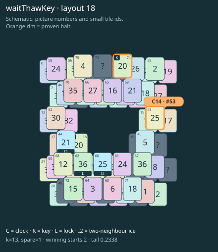

# waitThawKey · layout 18

Prepare the frozen key roof, use both keys to open the thaw tile, and melt the clock picture before collecting its exposed clock twin.

| Fact | Value |
|---|---|
| Tiles / layout | 76 / 18 (frame) |
| Clock | tile 53: 13 shortest + 1 spare = 14 |
| Winning first moves | 2 proven; 0 unresolved out of 13 |
| Dearest unrelated temptation | 69: loss through clock 16 |
| Tray on stored clock route | peak 3, run at 2+ = 12, visits to 3 = 6 |
| All-route tray bound | At least 3 waiting; {"cap1":"lose","cap2":"lose"} |
| Tail greedy win | 0.2338, 187/800, seed 977 |
| Face down | 25.0% |
| Close twins | 0 visible, 0 within four-copy pictures, 0 overall |
| UI dependency | none |

## Proven bait

- Tiles 74: loss through clock 16; no dearer than the unrelated control.
- Tiles 53: loss through clock 16; no dearer than the unrelated control.

## Each special matters

- lock 62: clockRoute; {"kind":"lock","tile":62,"by":"clockRoute","kWithout":1}
- ice 44: clockRoute; {"kind":"ice","tile":44,"by":"clockRoute","kWithout":1}
- ice 60: clockRoute; {"kind":"ice","tile":60,"by":"clockRoute","kWithout":11}

Easier: spare 2; obviousness dial 0. Harder: spare 1; obviousness dial 2 requires a greedy first bait.

[Board, strict solution and complete proof card](waitThawKey-L18-s4-p1.json)

The tray trace describes the stored route. The capacity proof, when resolved, covers all game routes. Tail greedy win is the specified fixed-seed diagnostic, not a human rating.

## Chain and opening facts

Signature: `clock<ice; thaw<lock; keyA<cover:ice; clock<waitForTwin`. Chain links: 4. Layers: 3.

Two traps: {"kind":"hardChainAndMediumBait","hardLinks":4,"mediumLinks":2,"mediumEvidence":[{"bait":[74],"kind":"earlyKey","links":2,"partner":18,"partnerCovers":[44],"opens":[62]},{"bait":[53],"kind":"waitingClock","links":2,"twin":60,"twinCovers":[]}],"baits":[[74],[53]],"note":"Two separately priced bad decisions on one connected chain; no claim of additive sequential costs."}

Two frozen fronts: []

Obviousness dial 0: first route taps 52, 14; greedy sets {"rank":"specialProgress","tiles":[52,53,74]} / {"rank":"specialProgress","tiles":[53,74]}. Greedy prefix: false; ready free route pair: false; greedy-preferred baits: [[74],[53]].

Tail waiting shares (before taps), 0 / 1 / 2 / 3: 0.381 / 0.476 / 0.111 / 0.032. Longest 2+ run: 4.
