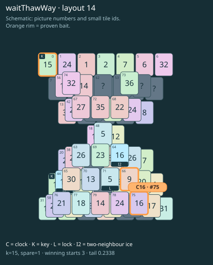

# waitThawWay · layout 14

The free clock must wait while an icy way yields the key pair that opens its twin’s thaw neighbour.

| Fact | Value |
|---|---|
| Tiles / layout | 80 / 14 (hourglass) |
| Clock | tile 75: 15 shortest + 1 spare = 16 |
| Winning first moves | 3 proven; 0 unresolved out of 12 |
| Dearest unrelated temptation | 6+74: +2 clock moves |
| Tray on stored clock route | peak 3, run at 2+ = 12, visits to 3 = 6 |
| All-route tray bound | At least 3 waiting; {"cap1":"lose","cap2":"lose"} |
| Tail greedy win | 0.2338, 187/800, seed 977 |
| Face down | 25.0% |
| Close twins | 0 visible, 0 within four-copy pictures, 0 overall |
| UI dependency | none |

## Proven bait

- Tiles 66: loss through clock 18; dearer than the unrelated control.
- Tiles 0: loss through clock 18; dearer than the unrelated control.
- Tiles 75: loss through clock 18; dearer than the unrelated control.

## Each special matters

- lock 71: clockRoute; {"kind":"lock","tile":71,"by":"clockRoute","kWithout":1}
- ice 44: clockRoute; {"kind":"ice","tile":44,"by":"clockRoute","kWithout":1}
- ice 64: clockRoute; {"kind":"ice","tile":64,"by":"clockRoute","kWithout":1}

Easier: spare 2; obviousness dial 0. Harder: spare 1; obviousness dial 2 requires a greedy first bait.

[Board, strict solution and complete proof card](waitThawWay-L14-s2-p1.json)

The tray trace describes the stored route. The capacity proof, when resolved, covers all game routes. Tail greedy win is the specified fixed-seed diagnostic, not a human rating.

## Chain and opening facts

Signature: `clock<ice; thaw<lock; keyA<way:ice; clock<waitForTwin`. Chain links: 4. Layers: 3.

Two traps: {"kind":"hardChainAndMediumBait","hardLinks":4,"mediumLinks":2,"baits":[[66],[0],[75]],"note":"Two separately priced bad decisions on one connected chain; no claim of additive sequential costs.","mediumEvidence":[{"bait":[66],"kind":"lonelyThaw","links":2,"thawHosts":[64],"twin":34,"twinCovers":[60,61,79,78,77]},{"bait":[0],"kind":"earlyKey","links":2,"partner":25,"partnerCovers":[44,65],"opens":[71]},{"bait":[75],"kind":"waitingClock","links":2,"twin":64,"twinCovers":[]}]}

Two frozen fronts: []

Obviousness dial 0: first route taps 63, 38; greedy sets {"rank":"freePair","tiles":[6,74]} / {"rank":"freePair","tiles":[6,38,67,74]}. Greedy prefix: false; ready free route pair: false; greedy-preferred baits: [].

Tail waiting shares (before taps), 0 / 1 / 2 / 3: 0.354 / 0.477 / 0.138 / 0.031. Longest 2+ run: 3.
