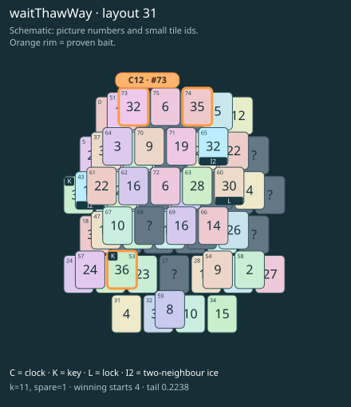

# waitThawWay · layout 31

The free clock must wait while an icy way yields the key pair that opens its twin’s thaw neighbour.

| Fact | Value |
|---|---|
| Tiles / layout | 76 / 31 (oval · two islands) |
| Clock | tile 73: 11 shortest + 1 spare = 12 |
| Winning first moves | 4 proven; 0 unresolved out of 13 |
| Dearest unrelated temptation | No candidates outside the mechanism |
| Tray on stored clock route | peak 3, run at 2+ = 10, visits to 3 = 5 |
| All-route tray bound | At least 3 waiting; {"cap1":"lose","cap2":"lose"} |
| Tail greedy win | 0.2238, 179/800, seed 977 |
| Face down | 25.0% |
| Close twins | 0 visible, 0 within four-copy pictures, 0 overall |
| UI dependency | none |

## Proven bait

- Tiles 74: loss through clock 14; dearer than the unrelated control.
- Tiles 53: loss through clock 14; dearer than the unrelated control.
- Tiles 73: loss through clock 14; dearer than the unrelated control.

## Each special matters

- lock 60: clockRoute; {"kind":"lock","tile":60,"by":"clockRoute","kWithout":1}
- ice 43: baitDefused; {"kind":"ice","tile":43,"by":"baitDefused","bait":[53],"winsAt":12}
- ice 65: clockRoute; {"kind":"ice","tile":65,"by":"clockRoute","kWithout":1}

Easier: spare 2; obviousness dial 0. Harder: spare 1; obviousness dial 2 requires a greedy first bait.

[Board, strict solution and complete proof card](waitThawWay-L31-s3-p1.json)

The tray trace describes the stored route. The capacity proof, when resolved, covers all game routes. Tail greedy win is the specified fixed-seed diagnostic, not a human rating.

## Chain and opening facts

Signature: `clock<ice; thaw<lock; keyA<way:ice; clock<waitForTwin`. Chain links: 4. Layers: 3.

Two traps: {"kind":"hardChainAndMediumBait","hardLinks":4,"mediumLinks":2,"mediumEvidence":[{"bait":[74],"kind":"lonelyThaw","links":2,"thawHosts":[65],"twin":18,"twinCovers":[47,67]},{"bait":[53],"kind":"earlyKey","links":2,"partner":11,"partnerCovers":[43,61],"opens":[60]},{"bait":[73],"kind":"waitingClock","links":2,"twin":65,"twinCovers":[]}],"baits":[[74],[53],[73]],"note":"Two separately priced bad decisions on one connected chain; no claim of additive sequential costs."}

Two frozen fronts: []

Obviousness dial 0: first route taps 64, 57; greedy sets {"rank":"specialProgress","tiles":[53,61,73,74]} / {"rank":"freePair","tiles":[54,70]}. Greedy prefix: false; ready free route pair: false; greedy-preferred baits: [[74],[53],[73]].

Tail waiting shares (before taps), 0 / 1 / 2 / 3: 0.369 / 0.477 / 0.123 / 0.031. Longest 2+ run: 4.
