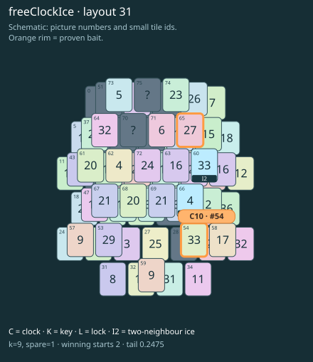

# freeClockIce · layout 31

The clock is already free, but taking it now uses the tray space needed for the two-stage thaw of its partner.

| Fact | Value |
|---|---|
| Tiles / layout | 76 / 31 (oval · two islands) |
| Clock | tile 54: 9 shortest + 1 spare = 10 |
| Winning first moves | 2 proven; 0 unresolved out of 13 |
| Dearest unrelated temptation | 57+59: +2 clock moves |
| Tray on stored clock route | peak 3, run at 2+ = 8, visits to 3 = 4 |
| All-route tray bound | At least 3 waiting; {"cap1":"lose","cap2":"lose"} |
| Tail greedy win | 0.2475, 198/800, seed 977 |
| Face down | 19.7% |
| Close twins | 0 visible, 0 within four-copy pictures, 0 overall |
| UI dependency | none |

## Proven bait

- Tiles 65: loss through clock 12; dearer than the unrelated control.
- Tiles 54: loss through clock 12; dearer than the unrelated control.

## Each special matters

- ice 60: clockRoute; {"kind":"ice","tile":60,"by":"clockRoute","kWithout":1}
- ice 66: clockRoute; {"kind":"ice","tile":66,"by":"clockRoute","kWithout":1}

Easier: spare 2; one wrong neighbour; shorter key dig. Harder: spare 1; two wrong neighbours; tail width 3.

[Board, strict solution and complete proof card](freeClockIce-L31-s3-p1.json)

The tray trace describes the stored route. The capacity proof, when resolved, covers all game routes. Tail greedy win is the specified fixed-seed diagnostic, not a human rating.
