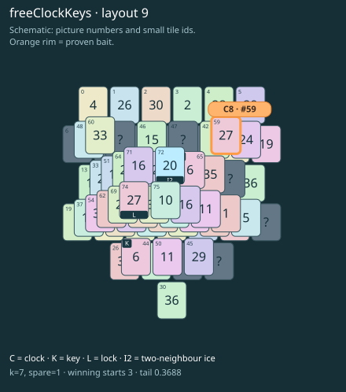

# freeClockKeys · layout 9

Leave the exposed clock until the frozen key roof is cleared, or its waiting picture blocks the key dig.

| Fact | Value |
|---|---|
| Tiles / layout | 76 / 9 (heart) |
| Clock | tile 59: 7 shortest + 1 spare = 8 |
| Winning first moves | 3 proven; 0 unresolved out of 9 |
| Dearest unrelated temptation | 5+45: +2 clock moves |
| Tray on stored clock route | peak 3, run at 2+ = 4, visits to 3 = 2 |
| All-route tray bound | At least 3 waiting; {"cap1":"lose","cap2":"lose"} |
| Tail greedy win | 0.3688, 295/800, seed 977 |
| Face down | 19.7% |
| Close twins | 0 visible, 0 within four-copy pictures, 0 overall |
| UI dependency | none |

## Proven bait

- Tiles 59: loss through clock 10; dearer than the unrelated control.

## Each special matters

- lock 74: clockRoute; {"kind":"lock","tile":74,"by":"clockRoute","kWithout":1}
- ice 72: clockRoute; {"kind":"ice","tile":72,"by":"clockRoute","kWithout":1}

Easier: spare 2; one wrong neighbour; shorter key dig. Harder: spare 1; two wrong neighbours; tail width 3.

[Board, strict solution and complete proof card](freeClockKeys-L9-s2-p1.json)

The tray trace describes the stored route. The capacity proof, when resolved, covers all game routes. Tail greedy win is the specified fixed-seed diagnostic, not a human rating.
