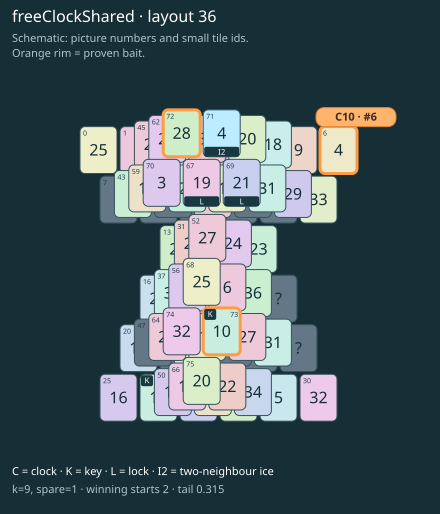

# freeClockShared · layout 36

The free clock and the free melting neighbour compete for tray room while the keys open the clock partner route.

| Fact | Value |
|---|---|
| Tiles / layout | 76 / 36 (hourglass) |
| Clock | tile 6: 9 shortest + 1 spare = 10 |
| Winning first moves | 2 proven; 0 unresolved out of 11 |
| Dearest unrelated temptation | 0+68: +2 clock moves |
| Tray on stored clock route | peak 3, run at 2+ = 8, visits to 3 = 4 |
| All-route tray bound | At least 3 waiting; {"cap1":"lose","cap2":"lose"} |
| Tail greedy win | 0.315, 252/800, seed 977 |
| Face down | 19.7% |
| Close twins | 0 visible, 0 within four-copy pictures, 0 overall |
| UI dependency | none |

## Proven bait

- Tiles 72: loss through clock 12; dearer than the unrelated control.
- Tiles 73: loss through clock 12; dearer than the unrelated control.
- Tiles 6: loss through clock 12; dearer than the unrelated control.

## Each special matters

- lock 69: clockRoute; {"kind":"lock","tile":69,"by":"clockRoute","kWithout":1}
- lock 67: clockRoute; {"kind":"lock","tile":67,"by":"clockRoute","kWithout":1}
- ice 71: clockRoute; {"kind":"ice","tile":71,"by":"clockRoute","kWithout":1}

Easier: spare 2; one wrong neighbour; shorter key dig. Harder: spare 1; two wrong neighbours; tail width 3.

[Board, strict solution and complete proof card](freeClockShared-L36-s1-p1.json)

The tray trace describes the stored route. The capacity proof, when resolved, covers all game routes. Tail greedy win is the specified fixed-seed diagnostic, not a human rating.
