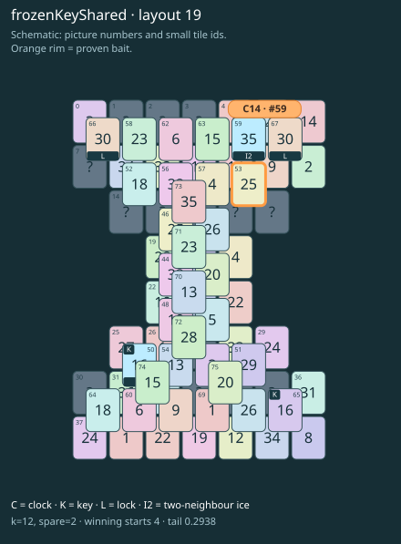

# frozenKeyShared · layout 19

The frozen key opens two separate exits, so thaw its route before spending a slot on the other key.

| Fact | Value |
|---|---|
| Tiles / layout | 76 / 19 (hourglass · ridges) |
| Clock | tile 59: 12 shortest + 2 spare = 14 |
| Winning first moves | 4 proven; 0 unresolved out of 10 |
| Dearest unrelated temptation | No candidates outside the mechanism |
| Tray on stored clock route | peak 3, run at 2+ = 9, visits to 3 = 4 |
| All-route tray bound | At least 3 waiting; {"cap1":"lose","cap2":"lose"} |
| Tail greedy win | 0.2938, 235/800, seed 977 |
| Face down | 18.4% |
| Close twins | 0 visible, 0 within four-copy pictures, 0 overall |
| UI dependency | TASK-13 |

## Proven bait

- Tiles 53: loss through clock 15; dearer than the unrelated control.

## Each special matters

- lock 67: clockRoute; {"kind":"lock","tile":67,"by":"clockRoute","kWithout":3}
- lock 66: clockRoute; {"kind":"lock","tile":66,"by":"clockRoute","kWithout":11}
- ice 50: clockRoute; {"kind":"ice","tile":50,"by":"clockRoute","kWithout":7}
- ice 59: clockRoute; {"kind":"ice","tile":59,"by":"clockRoute","kWithout":9}

Easier: spare 2; one wrong neighbour; shorter key dig. Harder: spare 1; two wrong neighbours; tail width 3.

[Board, strict solution and complete proof card](frozenKeyShared-L19-s6-p2.json)

The tray trace describes the stored route. The capacity proof, when resolved, covers all game routes. Tail greedy win is the specified fixed-seed diagnostic, not a human rating.
