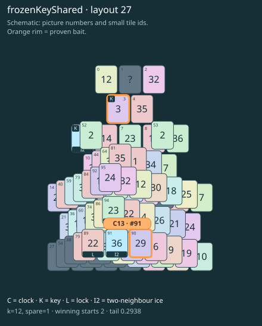

# frozenKeyShared · layout 27

The frozen key opens two separate exits, so thaw its route before spending a slot on the other key.

| Fact | Value |
|---|---|
| Tiles / layout | 96 / 27 (steps) |
| Clock | tile 91: 12 shortest + 1 spare = 13 |
| Winning first moves | 2 proven; 0 unresolved out of 9 |
| Dearest unrelated temptation | No candidates outside the mechanism |
| Tray on stored clock route | peak 3, run at 2+ = 5, visits to 3 = 3 |
| All-route tray bound | At least 3 waiting; {"cap1":"lose","cap2":"lose"} |
| Tail greedy win | 0.2938, 235/800, seed 977 |
| Face down | 19.8% |
| Close twins | 0 visible, 0 within four-copy pictures, 1 overall |
| UI dependency | TASK-13 |

## Proven bait

- Tiles 90: +3 clock moves; dearer than the unrelated control.
- Tiles 3: +3 clock moves; dearer than the unrelated control.

## Each special matters

- lock 89: baitDefused; {"kind":"lock","tile":89,"by":"baitDefused","bait":[90],"winsAt":13}
- lock 94: clockRoute; {"kind":"lock","tile":94,"by":"clockRoute","kWithout":10}
- ice 5: clockRoute; {"kind":"ice","tile":5,"by":"clockRoute","kWithout":7}
- ice 91: clockRoute; {"kind":"ice","tile":91,"by":"clockRoute","kWithout":2}

Easier: spare 2; one wrong neighbour; shorter key dig. Harder: spare 1; two wrong neighbours; tail width 3.

[Board, strict solution and complete proof card](frozenKeyShared-L27-s2-p1.json)

The tray trace describes the stored route. The capacity proof, when resolved, covers all game routes. Tail greedy win is the specified fixed-seed diagnostic, not a human rating.
