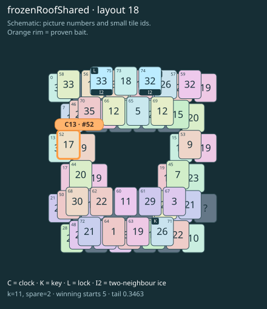

# frozenRoofShared · layout 18

The free clock shares its picture with a tile behind a roof that is both frozen and locked; prepare the far key route first.

| Fact | Value |
|---|---|
| Tiles / layout | 76 / 18 (frame) |
| Clock | tile 52: 11 shortest + 2 spare = 13 |
| Winning first moves | 5 proven; 0 unresolved out of 12 |
| Dearest unrelated temptation | 58: +0 clock moves |
| Tray on stored clock route | peak 3, run at 2+ = 10, visits to 3 = 5 |
| All-route tray bound | At least 3 waiting; {"cap1":"lose","cap2":"lose"} |
| Tail greedy win | 0.3463, 277/800, seed 977 |
| Face down | 19.7% |
| Close twins | 0 visible, 0 within four-copy pictures, 0 overall |
| UI dependency | TASK-13 |

## Proven bait

- Tiles 52: loss through clock 14; dearer than the unrelated control.

## Each special matters

- lock 75: clockRoute; {"kind":"lock","tile":75,"by":"clockRoute","kWithout":1}
- ice 74: clockRoute; {"kind":"ice","tile":74,"by":"clockRoute","kWithout":1}
- ice 75: clockRoute; {"kind":"ice","tile":75,"by":"clockRoute","kWithout":1}

Easier: spare 2; one wrong neighbour; shorter key dig. Harder: spare 1; two wrong neighbours; tail width 3.

[Board, strict solution and complete proof card](frozenRoofShared-L18-s6-p2.json)

The tray trace describes the stored route. The capacity proof, when resolved, covers all game routes. Tail greedy win is the specified fixed-seed diagnostic, not a human rating.
