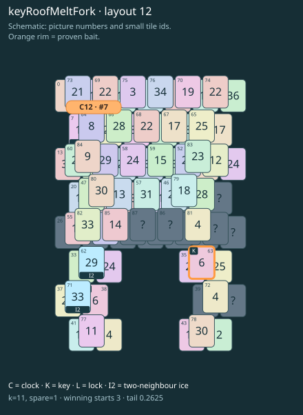

# keyRoofMeltFork · layout 12

Thaw the key roof through its own neighbour before collecting the two keys together.

| Fact | Value |
|---|---|
| Tiles / layout | 88 / 12 (arch) |
| Clock | tile 7: 11 shortest + 1 spare = 12 |
| Winning first moves | 3 proven; 0 unresolved out of 14 |
| Dearest unrelated temptation | 72+81: +2 clock moves |
| Tray on stored clock route | peak 3, run at 2+ = 9, visits to 3 = 4 |
| All-route tray bound | At least 3 waiting; {"cap1":"lose","cap2":"lose"} |
| Tail greedy win | 0.2625, 210/800, seed 977 |
| Face down | 19.3% |
| Close twins | 0 visible, 0 within four-copy pictures, 0 overall |
| UI dependency | none |

## Proven bait

- Tiles 63: loss through clock 14; dearer than the unrelated control.

## Each special matters

- lock 7: clockRoute; {"kind":"lock","tile":7,"by":"clockRoute","kWithout":2}
- ice 62: clockRoute; {"kind":"ice","tile":62,"by":"clockRoute","kWithout":8}
- ice 71: clockRoute; {"kind":"ice","tile":71,"by":"clockRoute","kWithout":5}

Easier: spare 2; one wrong neighbour; shorter key dig. Harder: spare 1; two wrong neighbours; tail width 3.

[Board, strict solution and complete proof card](keyRoofMeltFork-L12-s1-p1.json)

The tray trace describes the stored route. The capacity proof, when resolved, covers all game routes. Tail greedy win is the specified fixed-seed diagnostic, not a human rating.
