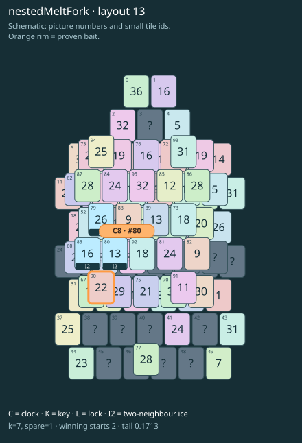

# nestedMeltFork · layout 13

Prepare both frozen thaw exits and save the lonely outer neighbour for its buried partner.

| Fact | Value |
|---|---|
| Tiles / layout | 96 / 13 (house) |
| Clock | tile 80: 7 shortest + 1 spare = 8 |
| Winning first moves | 2 proven; 0 unresolved out of 17 |
| Dearest unrelated temptation | 1: loss through clock 10 |
| Tray on stored clock route | peak 3, run at 2+ = 5, visits to 3 = 2 |
| All-route tray bound | At least 3 waiting; {"cap1":"lose","cap2":"lose"} |
| Tail greedy win | 0.1713, 137/800, seed 977 |
| Face down | 19.8% |
| Close twins | 0 visible, 0 within four-copy pictures, 0 overall |
| UI dependency | none |

## Proven bait

- Tiles 90: +2 clock moves; no dearer than the unrelated control.

## Each special matters

- ice 79: baitDefused; {"kind":"ice","tile":79,"by":"baitDefused","bait":[90],"winsAt":8}
- ice 80: clockRoute; {"kind":"ice","tile":80,"by":"clockRoute","kWithout":5}
- ice 83: clockRoute; {"kind":"ice","tile":83,"by":"clockRoute","kWithout":3}

Easier: spare 2; one wrong neighbour; shorter key dig. Harder: spare 1; two wrong neighbours; tail width 3.

[Board, strict solution and complete proof card](nestedMeltFork-L13-s3-p1.json)

The tray trace describes the stored route. The capacity proof, when resolved, covers all game routes. Tail greedy win is the specified fixed-seed diagnostic, not a human rating.
