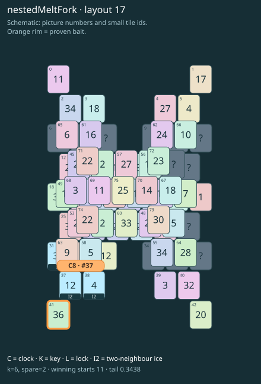

# nestedMeltFork · layout 17

Prepare both frozen thaw exits and save the lonely outer neighbour for its buried partner.

| Fact | Value |
|---|---|
| Tiles / layout | 76 / 17 (bowtie) |
| Clock | tile 37: 6 shortest + 2 spare = 8 |
| Winning first moves | 11 proven; 0 unresolved out of 24 |
| Dearest unrelated temptation | 5: loss through clock 9 |
| Tray on stored clock route | peak 3, run at 2+ = 5, visits to 3 = 2 |
| All-route tray bound | At least 3 waiting; {"cap1":"lose","cap2":"lose"} |
| Tail greedy win | 0.3438, 275/800, seed 977 |
| Face down | 17.1% |
| Close twins | 0 visible, 0 within four-copy pictures, 1 overall |
| UI dependency | none |

## Proven bait

- Tiles 41: loss through clock 9; no dearer than the unrelated control.

## Each special matters

- ice 31: clockRoute; {"kind":"ice","tile":31,"by":"clockRoute","kWithout":5}
- ice 37: clockRoute; {"kind":"ice","tile":37,"by":"clockRoute","kWithout":1}
- ice 38: clockRoute; {"kind":"ice","tile":38,"by":"clockRoute","kWithout":3}

Easier: spare 2; one wrong neighbour; shorter key dig. Harder: spare 1; two wrong neighbours; tail width 3.

[Board, strict solution and complete proof card](nestedMeltFork-L17-s4-p2.json)

The tray trace describes the stored route. The capacity proof, when resolved, covers all game routes. Tail greedy win is the specified fixed-seed diagnostic, not a human rating.
