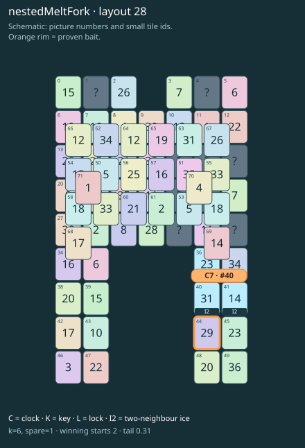

# nestedMeltFork · layout 28

Prepare both frozen thaw exits and save the lonely outer neighbour for its buried partner.

| Fact | Value |
|---|---|
| Tiles / layout | 72 / 28 (arch) |
| Clock | tile 40: 6 shortest + 1 spare = 7 |
| Winning first moves | 2 proven; 0 unresolved out of 20 |
| Dearest unrelated temptation | 0+39: +2 clock moves |
| Tray on stored clock route | peak 3, run at 2+ = 3, visits to 3 = 1 |
| All-route tray bound | At least 3 waiting; {"cap1":"lose","cap2":"lose"} |
| Tail greedy win | 0.31, 248/800, seed 977 |
| Face down | 12.5% |
| Close twins | 0 visible, 0 within four-copy pictures, 0 overall |
| UI dependency | none |

## Proven bait

- Tiles 44: +3 clock moves; dearer than the unrelated control.

## Each special matters

- ice 36: clockRoute; {"kind":"ice","tile":36,"by":"clockRoute","kWithout":5}
- ice 40: clockRoute; {"kind":"ice","tile":40,"by":"clockRoute","kWithout":1}
- ice 41: clockRoute; {"kind":"ice","tile":41,"by":"clockRoute","kWithout":3}

Easier: spare 2; one wrong neighbour; shorter key dig. Harder: spare 1; two wrong neighbours; tail width 3.

[Board, strict solution and complete proof card](nestedMeltFork-L28-s3-p1.json)

The tray trace describes the stored route. The capacity proof, when resolved, covers all game routes. Tail greedy win is the specified fixed-seed diagnostic, not a human rating.
