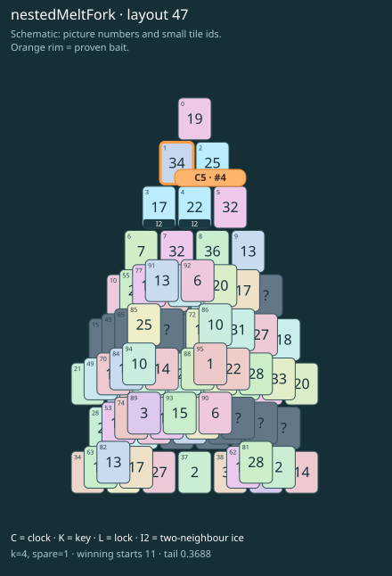

# nestedMeltFork · layout 47

Prepare both frozen thaw exits and save the lonely outer neighbour for its buried partner.

| Fact | Value |
|---|---|
| Tiles / layout | 96 / 47 (pyramid) |
| Clock | tile 4: 4 shortest + 1 spare = 5 |
| Winning first moves | 11 proven; 0 unresolved out of 15 |
| Dearest unrelated temptation | 82+91: +2 clock moves |
| Tray on stored clock route | peak 2, run at 2+ = 1, visits to 3 = 0 |
| All-route tray bound | At least 3 waiting; {"cap1":"lose","cap2":"lose"} |
| Tail greedy win | 0.3688, 295/800, seed 977 |
| Face down | 19.8% |
| Close twins | 0 visible, 0 within four-copy pictures, 0 overall |
| UI dependency | none |

## Proven bait

- Tiles 1: +3 clock moves; dearer than the unrelated control.

## Each special matters

- ice 2: clockRoute; {"kind":"ice","tile":2,"by":"clockRoute","kWithout":3}
- ice 3: baitDefused; {"kind":"ice","tile":3,"by":"baitDefused","bait":[1],"winsAt":5}
- ice 4: clockRoute; {"kind":"ice","tile":4,"by":"clockRoute","kWithout":2}

Easier: spare 2; one wrong neighbour; shorter key dig. Harder: spare 1; two wrong neighbours; tail width 3.

[Board, strict solution and complete proof card](nestedMeltFork-L47-s3-p1.json)

The tray trace describes the stored route. The capacity proof, when resolved, covers all game routes. Tail greedy win is the specified fixed-seed diagnostic, not a human rating.
