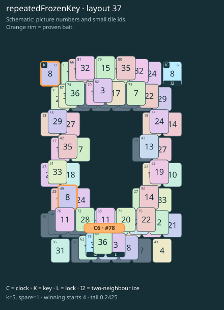

# repeatedFrozenKey · layout 37

The ordinary lookalike cannot replace the frozen key: thaw and pair the actual keys before using the shared picture elsewhere.

| Fact | Value |
|---|---|
| Tiles / layout | 84 / 37 (frame) |
| Clock | tile 78: 5 shortest + 1 spare = 6 |
| Winning first moves | 4 proven; 0 unresolved out of 19 |
| Dearest unrelated temptation | No candidates outside the mechanism |
| Tray on stored clock route | peak 3, run at 2+ = 4, visits to 3 = 2 |
| All-route tray bound | At least 2 waiting; {"cap1":"lose","cap2":"win"} |
| Tail greedy win | 0.2425, 194/800, seed 977 |
| Face down | 20.2% |
| Close twins | 0 visible, 0 within four-copy pictures, 2 overall |
| UI dependency | TASK-13 |

## Proven bait

- Tiles 0: +2 clock moves; dearer than the unrelated control.
- Tiles 0+49: +2 clock moves; dearer than the unrelated control.

## Each special matters

- lock 77: clockRoute; {"kind":"lock","tile":77,"by":"clockRoute","kWithout":3}
- ice 6: baitDefused; {"kind":"ice","tile":6,"by":"baitDefused","bait":[0],"winsAt":6}
- ice 78: clockRoute; {"kind":"ice","tile":78,"by":"clockRoute","kWithout":2}

Easier: spare 2; one wrong neighbour; shorter key dig. Harder: spare 1; two wrong neighbours; tail width 3.

[Board, strict solution and complete proof card](repeatedFrozenKey-L37-s1-p1.json)

The tray trace describes the stored route. The capacity proof, when resolved, covers all game routes. Tail greedy win is the specified fixed-seed diagnostic, not a human rating.
