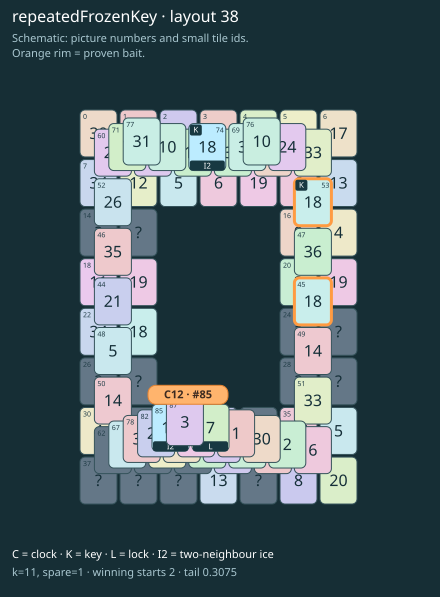

# repeatedFrozenKey · layout 38

The ordinary lookalike cannot replace the frozen key: thaw and pair the actual keys before using the shared picture elsewhere.

| Fact | Value |
|---|---|
| Tiles / layout | 88 / 38 (frame) |
| Clock | tile 85: 11 shortest + 1 spare = 12 |
| Winning first moves | 2 proven; 0 unresolved out of 13 |
| Dearest unrelated temptation | 49+50: +2 clock moves |
| Tray on stored clock route | peak 3, run at 2+ = 10, visits to 3 = 5 |
| All-route tray bound | At least 3 waiting; {"cap1":"lose","cap2":"lose"} |
| Tail greedy win | 0.3075, 246/800, seed 977 |
| Face down | 20.5% |
| Close twins | 0 visible, 0 within four-copy pictures, 0 overall |
| UI dependency | TASK-13 |

## Proven bait

- Tiles 53: +2 clock moves; no dearer than the unrelated control.
- Tiles 53+45: +2 clock moves; no dearer than the unrelated control.

## Each special matters

- lock 86: clockRoute; {"kind":"lock","tile":86,"by":"clockRoute","kWithout":9}
- ice 74: clockRoute; {"kind":"ice","tile":74,"by":"clockRoute","kWithout":9}
- ice 85: clockRoute; {"kind":"ice","tile":85,"by":"clockRoute","kWithout":9}

Easier: spare 2; one wrong neighbour; shorter key dig. Harder: spare 1; two wrong neighbours; tail width 3.

[Board, strict solution and complete proof card](repeatedFrozenKey-L38-s1-p1.json)

The tray trace describes the stored route. The capacity proof, when resolved, covers all game routes. Tail greedy win is the specified fixed-seed diagnostic, not a human rating.
