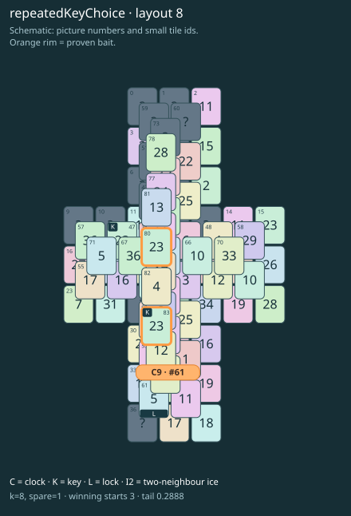

# repeatedKeyChoice · layout 8

Pictures can match while only one key leaves: pair the two real keys rather than the free key and its ordinary lookalike.

| Fact | Value |
|---|---|
| Tiles / layout | 84 / 8 (cross) |
| Clock | tile 61: 8 shortest + 1 spare = 9 |
| Winning first moves | 3 proven; 0 unresolved out of 7 |
| Dearest unrelated temptation | No candidates outside the mechanism |
| Tray on stored clock route | peak 3, run at 2+ = 3, visits to 3 = 1 |
| All-route tray bound | At least 3 waiting; {"cap1":"lose","cap2":"lose"} |
| Tail greedy win | 0.2888, 231/800, seed 977 |
| Face down | 20.2% |
| Close twins | 0 visible, 0 within four-copy pictures, 0 overall |
| UI dependency | none |

## Proven bait

- Tiles 83+80: +2 clock moves; dearer than the unrelated control.

## Each special matters

- lock 61: clockRoute; {"kind":"lock","tile":61,"by":"clockRoute","kWithout":5}

Easier: spare 2; one wrong neighbour; shorter key dig. Harder: spare 1; two wrong neighbours; tail width 3.

[Board, strict solution and complete proof card](repeatedKeyChoice-L8-s2-p1.json)

The tray trace describes the stored route. The capacity proof, when resolved, covers all game routes. Tail greedy win is the specified fixed-seed diagnostic, not a human rating.
