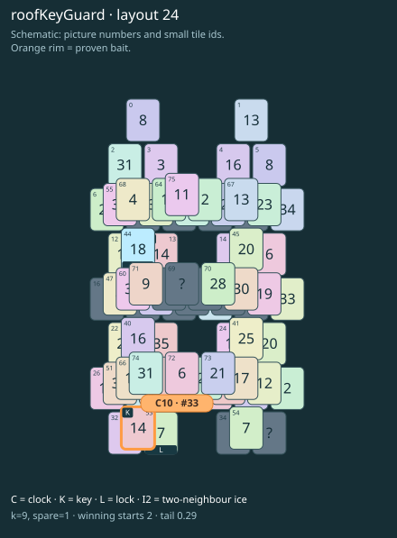

# roofKeyGuard · layout 24

The easy key lies on the clock, but its partner is behind an icy roof on the other side.

| Fact | Value |
|---|---|
| Tiles / layout | 76 / 24 (twins) |
| Clock | tile 33: 9 shortest + 1 spare = 10 |
| Winning first moves | 2 proven; 0 unresolved out of 18 |
| Dearest unrelated temptation | 0+5: +2 clock moves |
| Tray on stored clock route | peak 3, run at 2+ = 4, visits to 3 = 3 |
| All-route tray bound | At least 3 waiting; {"cap1":"lose","cap2":"lose"} |
| Tail greedy win | 0.29, 232/800, seed 977 |
| Face down | 19.7% |
| Close twins | 0 visible, 0 within four-copy pictures, 0 overall |
| UI dependency | none |

## Proven bait

- Tiles 53: loss through clock 12; dearer than the unrelated control.

## Each special matters

- lock 33: clockRoute; {"kind":"lock","tile":33,"by":"clockRoute","kWithout":2}
- ice 44: clockRoute; {"kind":"ice","tile":44,"by":"clockRoute","kWithout":4}

Easier: spare 2; one wrong neighbour; shorter key dig. Harder: spare 1; two wrong neighbours; tail width 3.

[Board, strict solution and complete proof card](roofKeyGuard-L24-s1-p1.json)

The tray trace describes the stored route. The capacity proof, when resolved, covers all game routes. Tail greedy win is the specified fixed-seed diagnostic, not a human rating.
