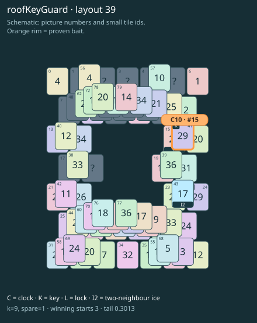

# roofKeyGuard · layout 39

The easy key lies on the clock, but its partner is behind an icy roof on the other side.

| Fact | Value |
|---|---|
| Tiles / layout | 80 / 39 (frame) |
| Clock | tile 15: 9 shortest + 1 spare = 10 |
| Winning first moves | 3 proven; 0 unresolved out of 15 |
| Dearest unrelated temptation | 0+56: +2 clock moves |
| Tray on stored clock route | peak 3, run at 2+ = 8, visits to 3 = 4 |
| All-route tray bound | At least 3 waiting; {"cap1":"lose","cap2":"lose"} |
| Tail greedy win | 0.3013, 241/800, seed 977 |
| Face down | 20.0% |
| Close twins | 0 visible, 0 within four-copy pictures, 0 overall |
| UI dependency | none |

## Proven bait

- Tiles 41: +2 clock moves; no dearer than the unrelated control.

## Each special matters

- lock 15: clockRoute; {"kind":"lock","tile":15,"by":"clockRoute","kWithout":2}
- ice 43: clockRoute; {"kind":"ice","tile":43,"by":"clockRoute","kWithout":4}

Easier: spare 2; one wrong neighbour; shorter key dig. Harder: spare 1; two wrong neighbours; tail width 3.

[Board, strict solution and complete proof card](roofKeyGuard-L39-s1-p1.json)

The tray trace describes the stored route. The capacity proof, when resolved, covers all game routes. Tail greedy win is the specified fixed-seed diagnostic, not a human rating.
