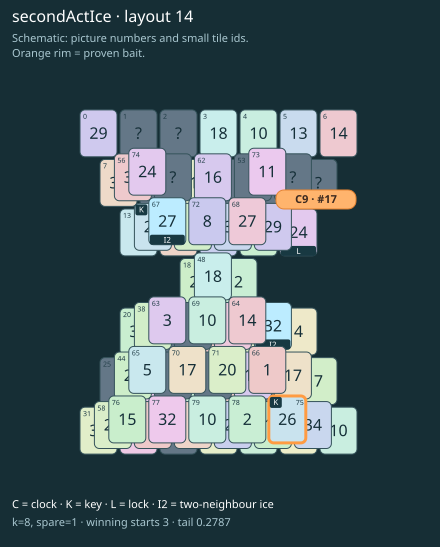

# secondActIce · layout 14

Saving the clock leaves an icy gate in the remaining picture route; keep space for the tiles that melt it.

| Fact | Value |
|---|---|
| Tiles / layout | 80 / 14 (hourglass) |
| Clock | tile 17: 8 shortest + 1 spare = 9 |
| Winning first moves | 3 proven; 0 unresolved out of 12 |
| Dearest unrelated temptation | No candidates outside the mechanism |
| Tray on stored clock route | peak 3, run at 2+ = 7, visits to 3 = 3 |
| All-route tray bound | At least 3 waiting; {"cap1":"lose","cap2":"lose"} |
| Tail greedy win | 0.2787, 223/800, seed 977 |
| Face down | 20.0% |
| Close twins | 0 visible, 0 within four-copy pictures, 0 overall |
| UI dependency | none |

## Proven bait

- Tiles 75: +2 clock moves; dearer than the unrelated control.

## Each special matters

- lock 17: clockRoute; {"kind":"lock","tile":17,"by":"clockRoute","kWithout":3}
- ice 39: tailGreedy; {"kind":"ice","tile":39,"by":"tailGreedy","with":0.2725,"without":0.5875,"delta":0.315,"seed":977,"playouts":400}
- ice 67: clockRoute; {"kind":"ice","tile":67,"by":"clockRoute","kWithout":6}

Easier: spare 2; one wrong neighbour; shorter key dig. Harder: spare 1; two wrong neighbours; tail width 3.

[Board, strict solution and complete proof card](secondActIce-L14-s1-p1.json)

The tray trace describes the stored route. The capacity proof, when resolved, covers all game routes. Tail greedy win is the specified fixed-seed diagnostic, not a human rating.
