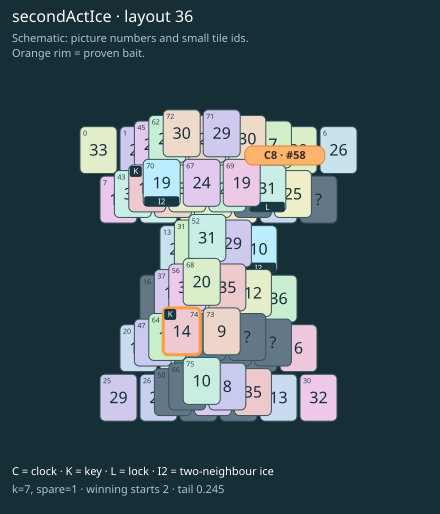

# secondActIce · layout 36

Saving the clock leaves an icy gate in the remaining picture route; keep space for the tiles that melt it.

| Fact | Value |
|---|---|
| Tiles / layout | 76 / 36 (hourglass) |
| Clock | tile 58: 7 shortest + 1 spare = 8 |
| Winning first moves | 2 proven; 0 unresolved out of 12 |
| Dearest unrelated temptation | 25+71: +2 clock moves |
| Tray on stored clock route | peak 3, run at 2+ = 6, visits to 3 = 3 |
| All-route tray bound | At least 3 waiting; {"cap1":"lose","cap2":"lose"} |
| Tail greedy win | 0.245, 196/800, seed 977 |
| Face down | 19.7% |
| Close twins | 0 visible, 0 within four-copy pictures, 1 overall |
| UI dependency | none |

## Proven bait

- Tiles 74: +3 clock moves; dearer than the unrelated control.

## Each special matters

- lock 58: clockRoute; {"kind":"lock","tile":58,"by":"clockRoute","kWithout":2}
- ice 15: tailFork; {"kind":"ice","tile":15,"by":"tailFork","prefix":[69,72,67,70,74,59,58,52,71,61,57,32,62,45,39,40,25,53],"bait":[75],"with":"lose","without":"win"}
- ice 70: clockRoute; {"kind":"ice","tile":70,"by":"clockRoute","kWithout":5}

Easier: spare 2; one wrong neighbour; shorter key dig. Harder: spare 1; two wrong neighbours; tail width 3.

[Board, strict solution and complete proof card](secondActIce-L36-s1-p1.json)

The tray trace describes the stored route. The capacity proof, when resolved, covers all game routes. Tail greedy win is the specified fixed-seed diagnostic, not a human rating.
