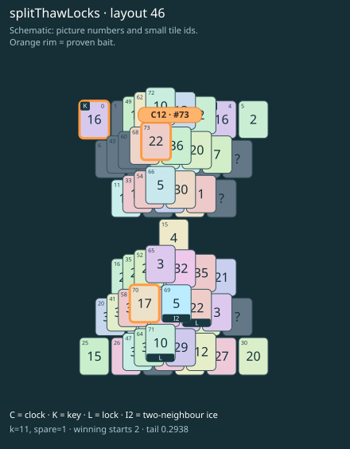

# splitThawLocks · layout 46

The locked thaw tile clears a picture carried through the key dig; save the free clock’s tray slot until that relief is ready.

| Fact | Value |
|---|---|
| Tiles / layout | 74 / 46 (hourglass) |
| Clock | tile 73: 11 shortest + 1 spare = 12 |
| Winning first moves | 2 proven; 0 unresolved out of 10 |
| Dearest unrelated temptation | 66: loss through clock 14 |
| Tray on stored clock route | peak 3, run at 2+ = 10, visits to 3 = 5 |
| All-route tray bound | At least 3 waiting; {"cap1":"lose","cap2":"lose"} |
| Tail greedy win | 0.2938, 235/800, seed 977 |
| Face down | 18.9% |
| Close twins | 0 visible, 0 within four-copy pictures, 0 overall |
| UI dependency | none |

## Proven bait

- Tiles 70: loss through clock 14; no dearer than the unrelated control.
- Tiles 0: loss through clock 14; no dearer than the unrelated control.
- Tiles 73: loss through clock 14; no dearer than the unrelated control.

## Each special matters

- lock 57: clockRoute; {"kind":"lock","tile":57,"by":"clockRoute","kWithout":5}
- lock 71: baitDefused; {"kind":"lock","tile":71,"by":"baitDefused","bait":[70],"winsAt":12}
- ice 69: clockRoute; {"kind":"ice","tile":69,"by":"clockRoute","kWithout":7}

Easier: spare 2; one wrong neighbour; shorter key dig. Harder: spare 1; two wrong neighbours; tail width 3.

[Board, strict solution and complete proof card](splitThawLocks-L46-s7-p1.json)

The tray trace describes the stored route. The capacity proof, when resolved, covers all game routes. Tail greedy win is the specified fixed-seed diagnostic, not a human rating.
