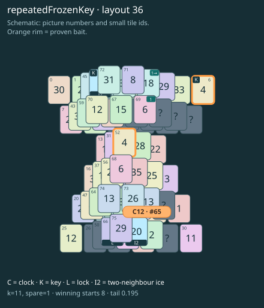

# Ribbon prototype · layout 36

Clear the numbered source before its arrow tile, then follow the melt route without parking the clock too early.

Take tile 69 (1) before tile 61 (1→). Removing this link reduces the exact clock route from 11 to 9. This is a separate demonstration board, not a numbered level.

The ordinary lookalike cannot replace the frozen key: thaw and pair the actual keys before using the shared picture elsewhere.

| Fact | Value |
|---|---|
| Tiles / layout | 76 / 36 (hourglass) |
| Clock | tile 65: 11 shortest + 1 spare = 12 |
| Winning first moves | 8 proven; 0 unresolved out of 13 |
| Dearest unrelated temptation | No candidates outside the mechanism |
| Tray on stored clock route | peak 3, run at 2+ = 8, visits to 3 = 4 |
| All-route tray bound | Unresolved: {"cap1":"unknown","cap2":"unknown"} |
| Tail greedy win | 0.195, 156/800, seed 977 |
| Face down | 19.7% |
| Close twins | 0 visible, 0 within four-copy pictures, 1 overall |
| UI dependency | TASK-13 |

## Proven bait

- Tiles 6+52: +2 clock moves; dearer than the unrelated control.

## Each special matters

- lock 66: clockRoute; {"kind":"lock","tile":66,"by":"clockRoute","kWithout":3}
- ice 62: clockRoute; {"kind":"ice","tile":62,"by":"clockRoute","kWithout":7}
- ice 65: clockRoute; {"kind":"ice","tile":65,"by":"clockRoute","kWithout":9}

Easier: spare 2; one wrong neighbour; shorter key dig. Harder: spare 1; two wrong neighbours; tail width 3.

[Board, strict solution and complete proof card](ribbon-L36.json)

The tray trace describes the stored route. The capacity proof, when resolved, covers all game routes. Tail greedy win is the specified fixed-seed diagnostic, not a human rating.
